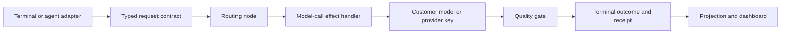

# Delegation architecture guide

Delegation is the beta workflow: a terminal or coding-agent adapter submits a task, routing selects a customer-configured backend, an effect handler calls the model, a quality gate evaluates the result, and the run emits a terminal outcome and receipt.

## Current references

| Page | Boundary |
|---|---|
| [Delegation dispatch](delegation-dispatch.md) | Request, model-call effect, quality gate and terminal event flow. |
| [Delegation routing contract](delegation-routing-contract.md) | Backend selection, configuration and output-token limits. |
| [Delegation routing ownership](omnimarket-delegation-routing-boundary.md) | Product routing ownership versus generic runtime transport. |
| [Delegation quickstart](../guides/delegation-quickstart.md) | The local beta path a user can run. |
| [Beta status](../reference/beta-status.md) | Availability of local and hosted surfaces. |

The local path can use an in-process bus. A self-hosted deployment carries the same workflow over its configured transport. A receipt proves what happened in one run; it does not establish a general quality or cost-saving claim.

## Historical designs

The [hook-driven delegation bridge](delegation-architecture.md) is deprecated. The [event-driven agent-routing proposal](event-driven-routing-proposal.md) and [routing comparison](routing-architecture-comparison.md) are history; agent selection is distinct from delegation backend routing. They point to the [agent-routing design](agent-routing-architecture.md).
