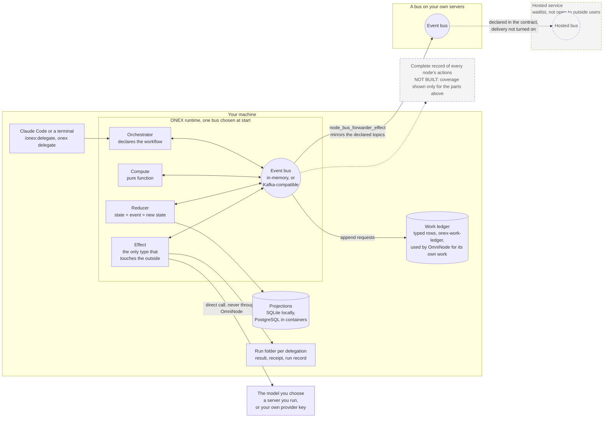
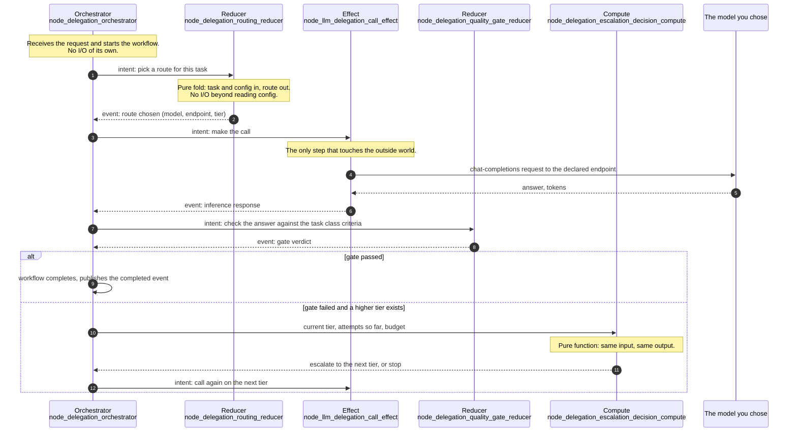
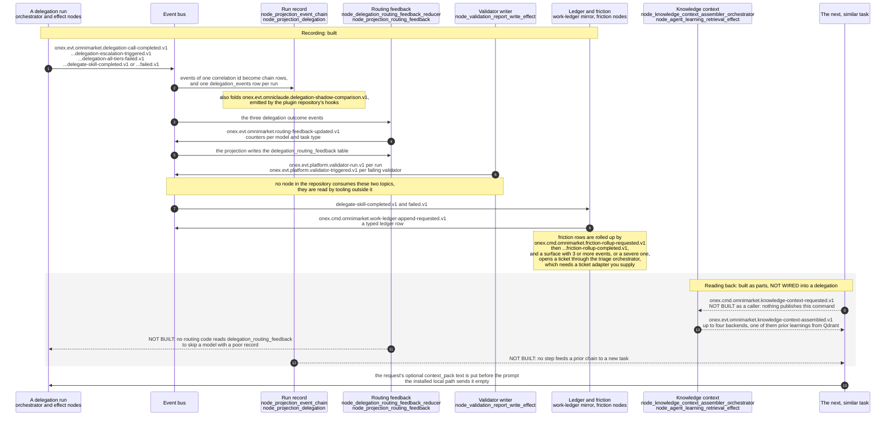
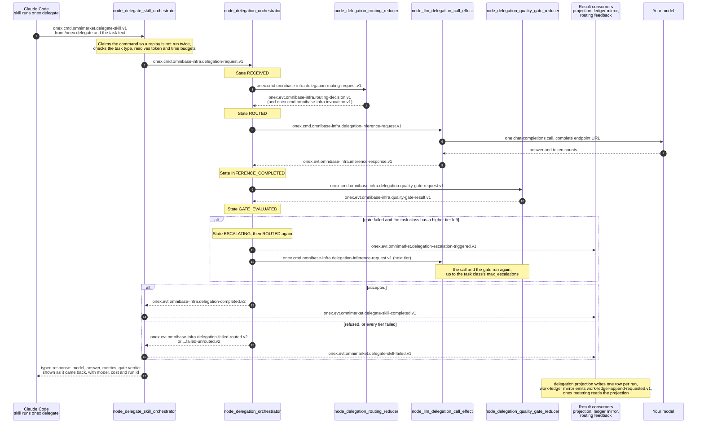
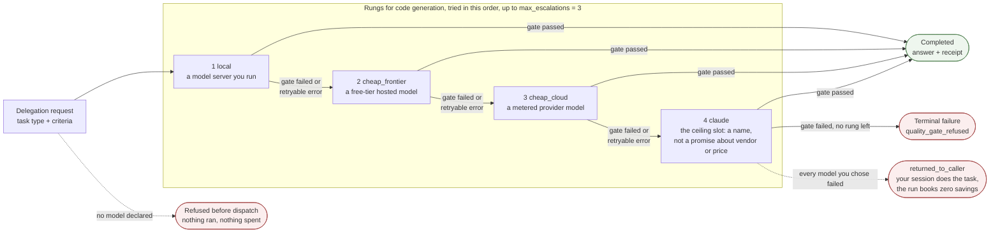
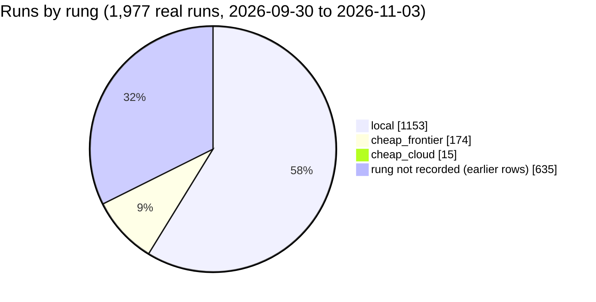
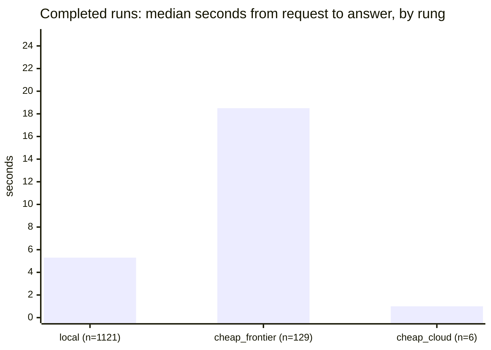
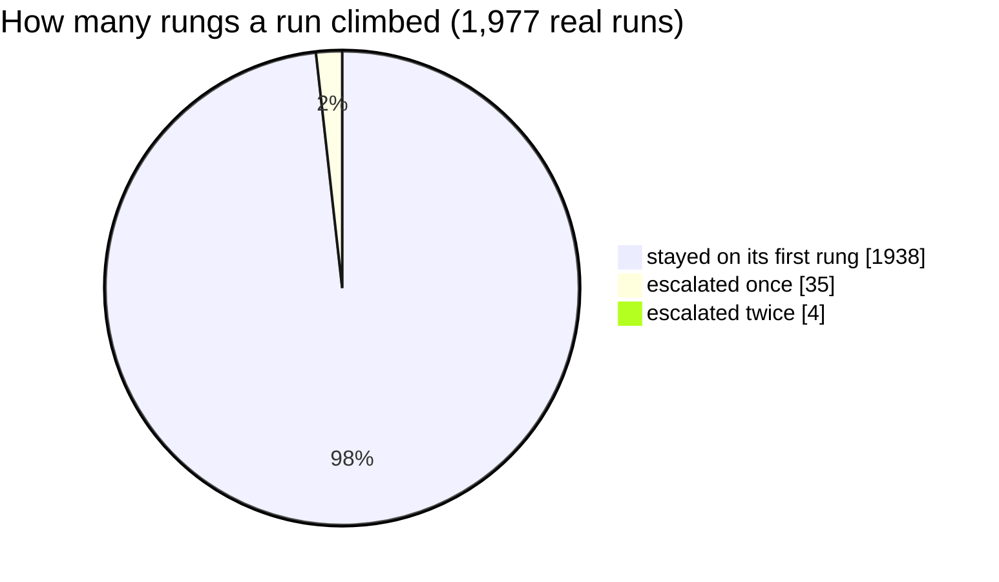
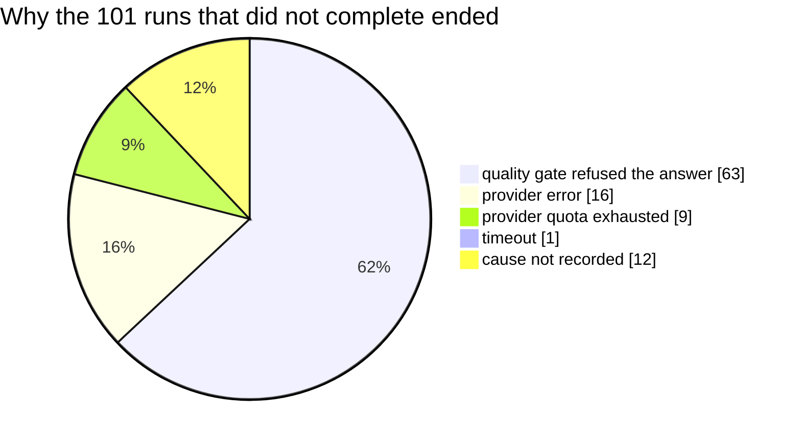

# How OmniNode works

This page is for a technical founder or lead who wants the whole design in about ten minutes
and does not want to start in a README. It says what the system does and why, gives one real
example for each part, and says plainly what is built and what is not. It was checked on
2026-11-06 against the public releases `omnibase-core 0.47.67`, `omnibase-infra 0.38.76`,
`omnimarket 0.4.320` and `omniclaude 0.27.0`. Where a part is a design that is not yet shown
working in a public release, the text says so.

If you only want to try it, skip to [the way in](#the-way-in-the-delegation-plugin) or go
straight to the [Delegation quickstart](onex-plugin-quickstart.md).

## The problem

Three things go wrong when coding agents do real work, and OmniNode is built around all three.

- **The agent is opaque.** You get an answer, and you cannot see which model produced it, what
  it looked at, or what it did on the way.
- **The outcome is not repeatable.** The same request can give a different result tomorrow, and
  there is no record that lets you replay what happened.
- **Context is unmanaged.** What the agent knew when it acted is whatever happened to be in its
  window, not something you chose, bounded or can inspect afterwards.

The answer is to put structure around the model rather than inside it. The model stays a
replaceable part. Everything around it is typed, recorded and checked.

## The whole picture

The diagram below puts the parts of the sections that follow on one page. Solid arrows are built
and were read in the released code. Dashed boxes and arrows are declared in a contract or planned
and are **not built end to end**.



Read it from the left: a request enters at the caller, the orchestrator turns it into events on the
bus, compute, reducer and effect nodes react to those events, and only an effect node reaches
outside the runtime. Reducers fold events into the projections that screens and tools read. The three buses are
joined only by forwarding nodes, and the last hop is the part that is not built.

## One bus, one record

Services in OmniNode do not call each other. Each piece does one job and communicates by
publishing and consuming typed events on an **event bus**. Which topics a piece reads and writes
is declared in its contract file, and the runtime resolves the addresses. Because of that, the
stream of events is a record of what happened: each state change, each action, each side effect
and each computation shows up as an event with a correlation id that ties one request's events
together.

State is derived from that record rather than queried from a service. A reducer folds events
into a **projection**, a read model, and screens and tools read projections. The
[state is materialized projection](../doctrine/state-is-materialized-projection.md) principle
explains why: when a field is missing, the first place to look is the projection that should
have produced it.

The design is hexagonal in the usual sense. The logic sits behind typed interfaces, and the
infrastructure is an adapter chosen when the runtime starts. The bus is one of those adapters:
an in-process in-memory bus by default, or a Kafka-compatible broker. Node code never sees which
one it is running on. The [deployment tiers guide](combining-deployment-tiers.md) shows the
switch and its limits.

What is built and what is not, for this part:

- **Built:** typed events, contract-declared topics, the in-memory and Kafka-compatible buses,
  and projections. You can run a real event chain on one machine with no broker and read it back
  out of a SQLite file, as the [local runtime guide](getting-started-local.md) shows.
- **Built:** a per-correlation ordered chain. The
  [event chain projection node](https://github.com/OmniNode-ai/omnimarket/blob/v0.4.320/src/omnimarket/nodes/node_projection_event_chain/contract.yaml)
  materializes one row per event for a correlation id, so the chain for one request can be
  rebuilt in order.
- **Built, for one use:** a typed work ledger, with nodes that append rows and fold them into
  state, and a read command, `onex-work-ledger`, shipped in `omnibase-core`. OmniNode uses it to
  track its own work.
- **Not shown:** that every node on the platform emits events to a ledger with the same
  coverage. The goal is a complete record of state changes, actions, side effects and
  computation. Published evidence covers the parts named above and no more.
- **A limit that matters on the shipped delegation path:** the installed `onex delegate` command
  runs without a broker, and its record is the per-run receipt folder, not a bus journal. The
  container stack, described in
  [Self-hosted quickstart](self-hosted-quickstart.md) (path 2),
  runs delegation through a broker and its projections. This page did not start that stack. The
  [dispatch architecture page](../architecture/delegation-dispatch.md) states the same boundary.

## The four node types

Every unit of behavior is a **node**, and every node is exactly one of four types. The type
decides what the node is allowed to do, and the platform checks it. A node is a thin shell
around a contract file and a handler class that holds the logic.

| Type | What it does | May touch the outside world | One real example from delegation |
|---|---|---|---|
| **Orchestrator** | Declares a workflow: which steps run, in what order, and what happens on failure. | No | [`node_delegate_skill_orchestrator`](https://github.com/OmniNode-ai/omnimarket/blob/v0.4.320/src/omnimarket/nodes/node_delegate_skill_orchestrator/contract.yaml) accepts a typed delegation request, validates the task type, and dispatches the delegation workflow. |
| **Reducer** | Takes the current state and one event and returns the new state. | No | [`node_delegation_routing_feedback_reducer`](https://github.com/OmniNode-ai/omnimarket/blob/v0.4.320/src/omnimarket/nodes/node_delegation_routing_feedback_reducer/contract.yaml) consumes delegation outcome events and keeps counters per model and task type. |
| **Effect** | Talks to the outside world: a model endpoint, a database, a CLI, a UI, a ticketing system. | Yes, and only here | [`node_llm_delegation_call_effect`](https://github.com/OmniNode-ai/omnimarket/blob/v0.4.320/src/omnimarket/nodes/node_llm_delegation_call_effect/contract.yaml) makes the call to an OpenAI-compatible endpoint and records cost. |
| **Compute** | A pure function: same input, same output, no I/O. | No | [`node_delegation_escalation_decision_compute`](https://github.com/OmniNode-ai/omnimarket/blob/v0.4.320/src/omnimarket/nodes/node_delegation_escalation_decision_compute/contract.yaml) decides from the current tier, the attempt count and the budget whether to try the next tier. |

The next diagram follows one request through all four types, using the nodes of the delegation
workflow that the table names. The orchestrator never calls a model and the effect never decides
anything: each type does only its own job, and the bus carries every hand-off.



Because only effect nodes touch the world, a bug that corrupts state or leaks data has one place
to live. Because compute and reducer nodes are pure, they can be tested by calling them and
replayed from recorded events. One caution: replaying events reproduces the platform's
decisions. It does not make a fresh model call return the same text, and the
[delegation dispatch page](../architecture/delegation-dispatch.md#replay-scope) says so.

To build one of each, follow the tutorials in [Building on the ONEX kernel](README.md#building-on-the-onex-kernel):
[compute](onex-node-building-03-compute-node-tutorial.md),
[effect](onex-node-building-04-effect-node-tutorial.md),
[reducer](onex-node-building-05-reducer-node-tutorial.md) and
[orchestrator](onex-node-building-06-orchestrator-node-tutorial.md). The tutorials in that
section are written, step by step guides. Animated versions of them are not published in this
repository yet.

## From one machine to a server to a hosted service

The same nodes can run against more than one bus, and buses can be joined. The pieces that
exist:

- **One bus per runtime, chosen at start.** `onex delegate` accepts `--bus inmemory` or
  `--bus kafka`, and `onex node` accepts `--backend event_bus=...`. Asking for Kafka without the
  Kafka package installed is an error, not a quiet fallback to in-memory, so you cannot believe
  you tested across processes when you did not.
- **A forwarding node.** [`node_bus_forwarder_effect`](https://github.com/OmniNode-ai/omnibase_infra/blob/v0.38.76/src/omnibase_infra/nodes/node_bus_forwarder_effect/contract.yaml)
  is an effect node that mirrors the topics its contract declares from one bus to another, with
  the tenant bound into every envelope. Its contract says a governed record without an admitted
  redaction state is dropped at the boundary, never forwarded.
- **A laptop-to-server mirror.** The container stack on one machine has an opt-in mode,
  `make up-local-mirror`, that forwards its delegation topics to a server bus you name in an
  overlay file. [Self-hosting the full stack](getting-started-self-hosted.md#a-separate-container-path-for-one-machine)
  describes the container stack it extends.

So the intended shape is local, then a bus on your own servers, then a hosted bus, each joined
by a forwarding node.

What is not built or not open:

- **The hosted service is not open to outside users.** Accounts are granted from a waitlist,
  nothing on the shipped path needs it, and the [cloud guide](connecting-to-the-cloud.md)
  describes its current state. The forwarder's cloud leg is declared in its contract, and the
  contract states that the declaration alone does not turn on delivery.
- **A three-hop chain, local to server to hosted, has no public end-to-end proof.** The
  [public proof index](../reference/public-proof-index.md) lists what has been inspected.

## Stop the line

The idea comes from Toyota's production line: when a defect appears, stop and fix it where it
happened, and work in small batches so that a stop is cheap. The platform's version is stated
in the [fail fast and loud](../doctrine/fail-fast-and-loud.md) doctrine. Detect a violation
immediately, say so aggressively, refuse an invalid state change, and never mark work complete
without durable evidence.

The mechanism is validators. A validator is a node that checks one rule over some input and
returns a standard report with a verdict of pass, warn, fail or error. The checks are generic,
so a new rule is a new node with a contract, not new machinery. In `omnibase-core` they cover
things like import direction between layers, forbidden patterns in code, and contract shape. A
failing check blocks the change that triggered it, in the repository's pre-commit hooks and in
CI, as this repository's own gate does for every page.

Validators also report on themselves. One effect node publishes a **run** event for each report
and a **fire** event for each finding, naming the rule that produced it, on the
`validator-run` topic. See the
[event model](https://github.com/OmniNode-ai/omnibase_core/blob/v0.47.67/src/omnibase_core/models/validation/model_validator_run_event.py)
and the
[writer node](https://github.com/OmniNode-ai/omnibase_core/blob/v0.47.67/src/omnibase_core/nodes/node_validation_report_write_effect/contract.yaml).
The reason is to count how often each rule fires. A rule that never fires is cost without
benefit, and a rule that fires constantly is a signal about the code or about the rule.

What is not built: nothing removes a rule for you. The counts exist as events; deciding that a
rule is no longer needed, and deleting it, is a person's decision. The writer node's contract
also records that no node in `omnibase-core` consumes the events, so reading them depends on a
consumer you run.

## Learning from earlier runs

The aim is that a new task starts with what earlier, similar tasks taught: the typed chain of
events from a prior run is available as context for the next one. This section traces what the
released code does today for that idea, using delegation as the example, and marks each step as
built or not built. It was read at `omnimarket 0.4.320`, `omnibase-core 0.47.67` and
`omniclaude 0.27.0`.

The answer to the question this page asked before is unchanged: **recording a run is built, a
reader for the record is built, and nothing yet reads the record back into the next task.**



What each part is, in words:

1. **The record of a run is built.** A delegation run emits typed events, and two projections turn
   them into queryable rows: one row per delegation, and a per-correlation event chain. The
   plugin repository's hooks also emit shadow-comparison events, which the delegation projection
   folds into its own table.
2. **Routing feedback is built as a counter, and its reader is missing.** The reducer counts
   completions, escalations and all-tiers-failed outcomes per model and task type, publishes the
   result and a projection stores it. Its contract says routing can use the counters to skip models
   with poor success rates. In the released code no routing step reads the stored counters, so the
   counters do not change a route today.
3. **Validator firing counts exist as events, with no consumer in the corpus.** The writer
   publishes a run event and one triggered event per failing validator. The count of how often each
   rule fires is therefore available to whoever reads those topics, and nothing in the repository
   acts on it.
4. **Ledger and friction rows are built, and they inform people.** The mirror turns delegation
   outcomes into typed ledger rows. The friction rollup counts friction by class, cost and
   recurrence, and the triage orchestrator opens a ticket for a recurring surface when an adapter is
   supplied. The reader of that output is a person or a later session, not the next delegation.
5. **The read-back side is built as parts.** The knowledge context assembler fans a request out to
   up to four backends and returns a bundle with graceful degradation, one backend being the
   retrieval of prior agent learnings from a vector store you run. No code in `omnimarket 0.4.320`, `omniclaude 0.27.0` or the latest `omniintelligence`
   release publishes the command that starts it. The worker that builds task context still assembles it
   from local signals and says in its own comments that the assembler is not yet wired. The
   context-pack orchestrator is called by the context compaction workflow, not by a delegation.
6. **The one live seam is a text field.** A delegation request can carry a `context_pack` string,
   which the workflow puts before the prompt and hashes into the event. Whoever builds the request
   decides what goes in it, and the installed local path sends an empty one.

So the statement on this page still holds at these releases: a closed loop in which prior event
chains are fed to the next similar task is **not built**, and no public measurement says how much
it would help. The pieces on both sides exist and have tests, and the join between them is the work
that is left. Context enrichment in the plugin repository is a separate, optional hook pipeline
described in [Context enrichment](../architecture/context-enrichment-pipeline.md). The
[overview page](what-is-omninode.md) makes the same statement about memory and enrichment.

## The way in: the delegation plugin

The first product on top of all this is delegation, and it is the shortest way to see the system
work. In Claude Code you type `/onex:delegate <task>`, or in a terminal `onex delegate "<task>"`.
The plugin is one skill that runs that command. The command does the following.

1. It classifies the task and reads your declared routing: your own model server, then
   progressively more capable tiers, ending at a ceiling tier. The names of the tiers are
   `local`, `cheap_cloud`, `cheap_frontier` and `claude` in the
   [routing contract](../architecture/delegation-routing-contract.md). Those names are slots, not
   promises about price or quality, and your effective route depends on what you declared.
2. It sends the task to the first suitable tier. Your machine calls that model directly, using
   your own endpoint or your own provider key. OmniNode does not sell inference and the call
   does not pass through an OmniNode service.
3. A quality gate checks the answer against criteria declared for that task class. If it fails,
   the task can escalate to the next tier, and if no tier is left the run ends with a refusal
   rather than a use of a credential you did not register.
4. Claude Code is shown the answer as it came back. The route, the model and the receipt are
   written to a run folder on your machine, and `onex metering` totals the spend against a
   baseline model.

A receipt says what the system reported. It does not prove the answer is correct, and a gate
pass means the declared criteria passed. Review generated work and run your own tests.

### One delegation, event by event

This is the path of one request through the platform's runtime, with the topic names as the node
contracts at the checked releases declare them. A topic name reads
`onex.<cmd or evt>.<owner>.<name>.<version>`: `cmd` is a command someone asked for, `evt` is a fact
that happened.



What each step is, in words:

1. **The catch.** In Claude Code the way in is the `/onex:delegate` skill from the customer plugin,
   which has one skill and no hooks. It runs one command. (The plugin repository also holds an
   optional hook on the `Agent` and `Task` tools that classifies a task and blocks the call when it
   looks delegatable. That hook is not part of the customer install, and this diagram starts at
   the skill.)
2. **The command event.** The entry node accepts a typed request, guards against a replayed
   delivery and publishes the runtime's own request. Its contract also declares a wall-clock bound
   on a delegation that stays unfinished, and a reaper for runs whose process went away.
3. **The workflow.** The orchestrator is a small state machine, `RECEIVED`, `ROUTED`,
   `INFERENCE_COMPLETED`, `GATE_EVALUATED`, `ESCALATING`, then `COMPLETED` or `FAILED`, and each
   arrow is triggered by an event, not by a function call. The routing and gate nodes are
   reducers, so a replay of the same events reproduces the same decisions. The effect node is the
   one that talks to a model.
4. **Escalation.** A failed gate or a retryable provider error asks the compute node
   `node_delegation_escalation_decision_compute` whether a higher tier is left and which one, and
   the orchestrator publishes the escalation as its own event. The next section draws the tiers.
5. **The records.** One terminal event closes the run. The delegation projection turns it into a
   row, the ledger mirror turns it into a ledger append request, and the routing feedback reducer
   counts outcomes per model.
6. **What Claude Code gets back.** A typed response naming the provider, the model, the answer,
   the metrics and the gate verdict. On a failure it carries a stable cause such as
   `quality_gate_refused`, `provider_quota_exhausted`, `auth_failed` or `timeout`.

This is the container stack's path, with a broker. The installed `onex delegate` runs the same
routing, effect, gate and escalation logic in one process through a local dispatch port, without a
broker, and writes the same kind of row to a local SQLite file. The
[dispatch architecture page](../architecture/delegation-dispatch.md) states the split. The event
trace above was read from the node contracts at `omnimarket 0.4.320`. No live event stream was
captured for this page.

### The rungs, from your machine outward

Routing tries the cheapest rung that fits and moves outward only when an answer fails its gate
or a provider fails in a way another rung can fix. Each task class declares its own ordered,
closed list of rungs. The example is the code-generation class at `omnimarket 0.4.320`.



The rung names are slots, not promises. Which rungs your install can reach depends on the
endpoints you declared and the provider keys you registered, and the order differs between task
classes (the repository default for a class that declares none is `local`, `cheap_cloud`,
`cheap_frontier`, `claude`). A refusal or an exhausted ladder is a terminal outcome, never a use
of a credential you did not register. The
[routing contract](../architecture/delegation-routing-contract.md) owns the configuration.

### Measured delegation outcomes

These charts come from real delegation runs, not from a model of them. They are an **author
report**: the maintainers' own delegation store, read on 2026-11-06, covering the 1,977 runs
recorded with `data_source = 'real'` between 2026-09-30 and 2026-11-03. Test, shadow and
synthetic rows are excluded. The store is a local SQLite file, the same `delegation_events`
table that `onex delegate` writes on your machine, and it is not published, so these figures are
not independently replicated. The runs were mixed task types (mostly summarization, document
drafting, review and reasoning) sent to whatever the maintainers had declared at the time, so the
rungs below are **not** a like-for-like comparison of price or quality.





The `cheap_cloud` bar rests on six runs and says little. For the other two the slow end is much
slower than the middle: the 90th percentile of completed runs was 40.1 seconds for `local` and
94.1 seconds for `cheap_frontier`.





Of the 1,977 runs, 1,876 completed and 101 did not. Most runs finished on the first rung, and when
one did not, the most common reason was the gate refusing an answer, which is the gate doing its
job. Money: `local` and `cheap_frontier` rows record a cost of $0.00, and the 15 `cheap_cloud`
runs recorded $0.0083 in total. The 635 earlier rows with no rung recorded cost $0.54 in total. A
cost of zero on a free-tier or self-hosted rung is a recorded price, not the cost of the machine
that ran it.

<details>
<summary>How the numbers were computed</summary>

Each figure is a query over the maintainers' store, a copy of which was read on 2026-11-06. The
same queries run against your own `~/.omninode/delegation/delegation.sqlite` after you have
delegated for a while.

```sql
-- runs by rung
SELECT COALESCE(cost_tier_name, 'not recorded'), COUNT(*)
FROM delegation_events WHERE data_source = 'real' GROUP BY 1;
-- median latency of completed runs per rung: take latency_ms where terminal_ok = 1,
-- sort, take the middle value
SELECT latency_ms FROM delegation_events
WHERE data_source = 'real' AND terminal_ok = 1 AND cost_tier_name = :rung;
-- escalations and failure causes
SELECT escalation_count, COUNT(*) FROM delegation_events
WHERE data_source = 'real' GROUP BY 1;
SELECT terminal_failure_cause, COUNT(*) FROM delegation_events
WHERE data_source = 'real' AND terminal_ok = 0 GROUP BY 1;
```

</details>

## Where to go next

| If you want to | Read |
|---|---|
| Try delegation in about 15 minutes | [Delegation quickstart](onex-plugin-quickstart.md) |
| Run it on one machine, with or without containers | [Self-hosted quickstart](self-hosted-quickstart.md) |
| Build your own nodes | the tutorials in [Building on the ONEX kernel](README.md#building-on-the-onex-kernel) |
| See what ships and what is in beta | [What OmniNode is, and where it stands](what-is-omninode.md) |
| See how the repositories fit together | [Repository map and runtime concepts](../architecture/repository-map-and-runtime-concepts.md) |
| Check the evidence behind a claim | [Public proof index](../reference/public-proof-index.md) |
