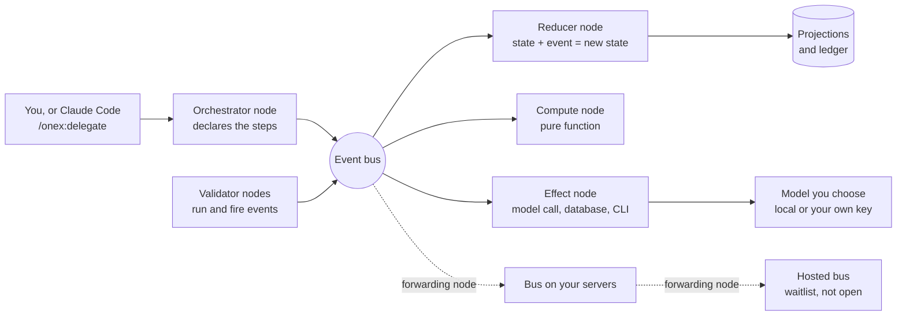

# How OmniNode works

This page is for a technical founder or lead who wants the whole design in about ten minutes
and does not want to start in a README. It says what the system does and why, gives one real
example for each part, and says plainly what is built and what is not. It was checked on
2026-11-06 against the public releases `omnibase-core 0.47.67`, `omnibase-infra 0.38.76`,
`omnimarket 0.4.320` and `omniclaude 0.27.0`. Where a part is a design that is not yet shown
working in a public release, the text says so.

If you only want to try it, skip to [the way in](#the-way-in-the-delegation-plugin) or go
straight to the [Delegation quickstart](onex-plugin-quickstart.md).

## The problem

Three things go wrong when coding agents do real work, and OmniNode is built around all three.

- **The agent is opaque.** You get an answer, and you cannot see which model produced it, what
  it looked at, or what it did on the way.
- **The outcome is not repeatable.** The same request can give a different result tomorrow, and
  there is no record that lets you replay what happened.
- **Context is unmanaged.** What the agent knew when it acted is whatever happened to be in its
  window, not something you chose, bounded or can inspect afterwards.

The answer is to put structure around the model rather than inside it. The model stays a
replaceable part. Everything around it is typed, recorded and checked.

## One bus, one record

Services in OmniNode do not call each other. Each piece does one job and communicates by
publishing and consuming typed events on an **event bus**. Which topics a piece reads and writes
is declared in its contract file, and the runtime resolves the addresses. Because of that, the
stream of events is a record of what happened: each state change, each action, each side effect
and each computation shows up as an event with a correlation id that ties one request's events
together.

State is derived from that record rather than queried from a service. A reducer folds events
into a **projection**, a read model, and screens and tools read projections. The
[state is materialized projection](../doctrine/state-is-materialized-projection.md) principle
explains why: when a field is missing, the first place to look is the projection that should
have produced it.

The design is hexagonal in the usual sense. The logic sits behind typed interfaces, and the
infrastructure is an adapter chosen when the runtime starts. The bus is one of those adapters:
an in-process in-memory bus by default, or a Kafka-compatible broker. Node code never sees which
one it is running on. The [deployment tiers guide](combining-deployment-tiers.md) shows the
switch and its limits.

What is built and what is not, for this part:

- **Built:** typed events, contract-declared topics, the in-memory and Kafka-compatible buses,
  and projections. You can run a real event chain on one machine with no broker and read it back
  out of a SQLite file, as the [local runtime guide](getting-started-local.md) shows.
- **Built:** a per-correlation ordered chain. The
  [event chain projection node](https://github.com/OmniNode-ai/omnimarket/blob/v0.4.320/src/omnimarket/nodes/node_projection_event_chain/contract.yaml)
  materializes one row per event for a correlation id, so the chain for one request can be
  rebuilt in order.
- **Built, for one use:** a typed work ledger, with nodes that append rows and fold them into
  state, and a read command, `onex-work-ledger`, shipped in `omnibase-core`. OmniNode uses it to
  track its own work.
- **Not shown:** that every node on the platform emits events to a ledger with the same
  coverage. The goal is a complete record of state changes, actions, side effects and
  computation. Published evidence covers the parts named above and no more.
- **A limit that matters on the shipped delegation path:** the installed `onex delegate` command
  runs without a broker, and its record is the per-run receipt folder, not a bus journal. The
  container stack, described in
  [Self-hosting the full stack](getting-started-self-hosted.md#a-separate-container-path-for-one-machine),
  runs delegation through a broker and its projections. This page did not start that stack. The
  [dispatch architecture page](../architecture/delegation-dispatch.md) states the same boundary.

## The four node types

Every unit of behavior is a **node**, and every node is exactly one of four types. The type
decides what the node is allowed to do, and the platform checks it. A node is a thin shell
around a contract file and a handler class that holds the logic.

| Type | What it does | May touch the outside world | One real example from delegation |
|---|---|---|---|
| **Orchestrator** | Declares a workflow: which steps run, in what order, and what happens on failure. | No | [`node_delegate_skill_orchestrator`](https://github.com/OmniNode-ai/omnimarket/blob/v0.4.320/src/omnimarket/nodes/node_delegate_skill_orchestrator/contract.yaml) accepts a typed delegation request, validates the task type, and dispatches the delegation workflow. |
| **Reducer** | Takes the current state and one event and returns the new state. | No | [`node_delegation_routing_feedback_reducer`](https://github.com/OmniNode-ai/omnimarket/blob/v0.4.320/src/omnimarket/nodes/node_delegation_routing_feedback_reducer/contract.yaml) consumes delegation outcome events and keeps counters per model and task type. |
| **Effect** | Talks to the outside world: a model endpoint, a database, a CLI, a UI, a ticketing system. | Yes, and only here | [`node_llm_delegation_call_effect`](https://github.com/OmniNode-ai/omnimarket/blob/v0.4.320/src/omnimarket/nodes/node_llm_delegation_call_effect/contract.yaml) makes the call to an OpenAI-compatible endpoint and records cost. |
| **Compute** | A pure function: same input, same output, no I/O. | No | [`node_delegation_escalation_decision_compute`](https://github.com/OmniNode-ai/omnimarket/blob/v0.4.320/src/omnimarket/nodes/node_delegation_escalation_decision_compute/contract.yaml) decides from the current tier, the attempt count and the budget whether to try the next tier. |

Because only effect nodes touch the world, a bug that corrupts state or leaks data has one place
to live. Because compute and reducer nodes are pure, they can be tested by calling them and
replayed from recorded events. One caution: replaying events reproduces the platform's
decisions. It does not make a fresh model call return the same text, and the
[delegation dispatch page](../architecture/delegation-dispatch.md#replay-scope) says so.

To build one of each, follow the tutorials in [Building on the ONEX kernel](README.md#building-on-the-onex-kernel):
[compute](onex-node-building-03-compute-node-tutorial.md),
[effect](onex-node-building-04-effect-node-tutorial.md),
[reducer](onex-node-building-05-reducer-node-tutorial.md) and
[orchestrator](onex-node-building-06-orchestrator-node-tutorial.md). The tutorials in that
section are written, step by step guides. Animated versions of them are not published in this
repository yet.

## From one machine to a server to a hosted service

The same nodes can run against more than one bus, and buses can be joined. The pieces that
exist:

- **One bus per runtime, chosen at start.** `onex delegate` accepts `--bus inmemory` or
  `--bus kafka`, and `onex node` accepts `--backend event_bus=...`. Asking for Kafka without the
  Kafka package installed is an error, not a quiet fallback to in-memory, so you cannot believe
  you tested across processes when you did not.
- **A forwarding node.** [`node_bus_forwarder_effect`](https://github.com/OmniNode-ai/omnibase_infra/blob/v0.38.76/src/omnibase_infra/nodes/node_bus_forwarder_effect/contract.yaml)
  is an effect node that mirrors the topics its contract declares from one bus to another, with
  the tenant bound into every envelope. Its contract says a governed record without an admitted
  redaction state is dropped at the boundary, never forwarded.
- **A laptop-to-server mirror.** The container stack on one machine has an opt-in mode,
  `make up-local-mirror`, that forwards its delegation topics to a server bus you name in an
  overlay file. [Self-hosting the full stack](getting-started-self-hosted.md#a-separate-container-path-for-one-machine)
  describes the container stack it extends.

So the intended shape is local, then a bus on your own servers, then a hosted bus, each joined
by a forwarding node.

What is not built or not open:

- **The hosted service is not open to outside users.** Accounts are granted from a waitlist,
  nothing on the shipped path needs it, and the [cloud guide](connecting-to-the-cloud.md)
  describes its current state. The forwarder's cloud leg is declared in its contract, and the
  contract states that the declaration alone does not turn on delivery.
- **A three-hop chain, local to server to hosted, has no public end-to-end proof.** The
  [public proof index](../reference/public-proof-index.md) lists what has been inspected.

## Stop the line

The idea comes from Toyota's production line: when a defect appears, stop and fix it where it
happened, and work in small batches so that a stop is cheap. The platform's version is stated
in the [fail fast and loud](../doctrine/fail-fast-and-loud.md) doctrine. Detect a violation
immediately, say so aggressively, refuse an invalid state change, and never mark work complete
without durable evidence.

The mechanism is validators. A validator is a node that checks one rule over some input and
returns a standard report with a verdict of pass, warn, fail or error. The checks are generic,
so a new rule is a new node with a contract, not new machinery. In `omnibase-core` they cover
things like import direction between layers, forbidden patterns in code, and contract shape. A
failing check blocks the change that triggered it, in the repository's pre-commit hooks and in
CI, as this repository's own gate does for every page.

Validators also report on themselves. One effect node publishes a **run** event for each report
and a **fire** event for each finding, naming the rule that produced it, on the
`validator-run` topic. See the
[event model](https://github.com/OmniNode-ai/omnibase_core/blob/v0.47.67/src/omnibase_core/models/validation/model_validator_run_event.py)
and the
[writer node](https://github.com/OmniNode-ai/omnibase_core/blob/v0.47.67/src/omnibase_core/nodes/node_validation_report_write_effect/contract.yaml).
The reason is to count how often each rule fires. A rule that never fires is cost without
benefit, and a rule that fires constantly is a signal about the code or about the rule.

What is not built: nothing removes a rule for you. The counts exist as events; deciding that a
rule is no longer needed, and deleting it, is a person's decision. The writer node's contract
also records that no node in `omnibase-core` consumes the events, so reading them depends on a
consumer you run.

## Learning from earlier runs

The aim is that a new task starts with what earlier, similar tasks taught: the typed chain of
events from a prior run is available as context for the next one. What exists in public
releases are the parts on either side of that idea.

- The per-correlation event chain described above is the typed record of a run.
- [`node_agent_learning_retrieval_effect`](https://github.com/OmniNode-ai/omnimarket/blob/v0.4.320/src/omnimarket/nodes/node_agent_learning_retrieval_effect/contract.yaml)
  looks up stored learning records by error signature or by task context, using a vector store.
  It needs a Qdrant instance that you run.
- The context pack nodes assemble the context for a task from declared tiers, in a fixed order
  and within a budget. [Context enrichment](../architecture/context-enrichment-pipeline.md)
  describes the related hook pipeline, which is optional and off unless enabled.
- The routing feedback reducer shown in the table keeps per-model counters from outcome events,
  and its contract says routing can use them to skip models with poor success rates.

What is not shown: a closed loop in which prior event chains are fed to the next similar task,
with a measured improvement. Nothing in the installed delegation plugin does this, and no public
measurement says how much it would help. The
[overview page](what-is-omninode.md) makes the same statement about memory and enrichment.

## The way in: the delegation plugin

The first product on top of all this is delegation, and it is the shortest way to see the system
work. In Claude Code you type `/onex:delegate <task>`, or in a terminal `onex delegate "<task>"`.
The plugin is one skill that runs that command. The command does the following.

1. It classifies the task and reads your declared routing: your own model server, then
   progressively more capable tiers, ending at a ceiling tier. The names of the tiers are
   `local`, `cheap_cloud`, `cheap_frontier` and `claude` in the
   [routing contract](../architecture/delegation-routing-contract.md). Those names are slots, not
   promises about price or quality, and your effective route depends on what you declared.
2. It sends the task to the first suitable tier. Your machine calls that model directly, using
   your own endpoint or your own provider key. OmniNode does not sell inference and the call
   does not pass through an OmniNode service.
3. A quality gate checks the answer against criteria declared for that task class. If it fails,
   the task can escalate to the next tier, and if no tier is left the run ends with a refusal
   rather than a use of a credential you did not register.
4. Claude Code is shown the answer as it came back. The route, the model and the receipt are
   written to a run folder on your machine, and `onex metering` totals the spend against a
   baseline model.

A receipt says what the system reported. It does not prove the answer is correct, and a gate
pass means the declared criteria passed. Review generated work and run your own tests.

The diagram shows the platform design. On the installed local path the bus step is not used, as
the first section explains.

## Where to go next

| If you want to | Read |
|---|---|
| Try delegation in about 15 minutes | [Delegation quickstart](onex-plugin-quickstart.md) |
| Run the platform on one machine, in containers | [Self-hosting the full stack](getting-started-self-hosted.md#a-separate-container-path-for-one-machine) |
| Build your own nodes | the tutorials in [Building on the ONEX kernel](README.md#building-on-the-onex-kernel) |
| See what ships and what is in beta | [What OmniNode is, and where it stands](what-is-omninode.md) |
| See how the repositories fit together | [Repository map and runtime concepts](../architecture/repository-map-and-runtime-concepts.md) |
| Check the evidence behind a claim | [Public proof index](../reference/public-proof-index.md) |
