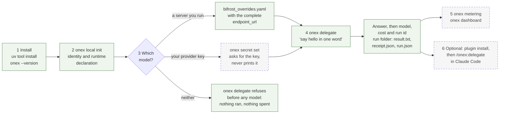

# Self-hosted quickstart: run OmniNode on one machine

This page is the short path. It gets OmniNode running on one machine you control, with no
OmniNode account and no hosted service, and it says for each step how it was checked. It does
not replace the longer guides, which it links where they hold the detail.

There are two paths on one machine. Start with the first.

| | Path 1: the tool | Path 2: the container stack |
|---|---|---|
| What you get | The `onex` command, delegation to a model you choose, a receipt for each run, spend metering, a local dashboard | The platform's own services in containers on the same machine: a Kafka-compatible broker, PostgreSQL, a cache, the runtime, and projections, with delegation running through the broker |
| Needs containers | No | Yes |
| Time | A few minutes plus the model setup | Several minutes for the first image build and boot |
| Use it to | Hand work to your own model and see what it cost | See the event flow and the projections described in [How OmniNode works](how-omninode-works.md) |

State of this page: checked on 2026-11-06 against `omnibase-core 0.47.67`, `omnibase-infra
0.38.76` and `omnimarket 0.4.320`. The section [How this was checked](#how-this-was-checked)
says which commands were run and which were only read in source.

## The path at a glance

Two diagrams follow, one per path, from the first command to the first delegation. Green boxes
are commands that were run for this page on 2026-11-06. Dashed grey boxes were read in the source
or in the tool's help and were not run for this page. The section
[How this was checked](#how-this-was-checked) gives the detail for each.

Path 1, the tool, with no containers:



Path 2, the container stack on the same machine. It is optional and was not started for this
page, so every box is read from the source:

```mermaid
flowchart LR
  c1["git clone omnibase_infra<br/>at the checked tag<br/>uv sync"] --> c2["make local-env<br/>generated passwords<br/>and a model overlay"]
  c2 --> c3["Edit model_endpoint<br/>in the overlay to your<br/>model's complete URL"]
  c3 --> c4["make up-local<br/>builds the runtime image,<br/>boots broker, PostgreSQL,<br/>cache and runtime"]
  c4 --> c5["make status-local<br/>migration gate, health on<br/>ports 8085 and 8086,<br/>delegate consumer group"]
  c5 --> c6["make delegate-local<br/>delegation through the broker,<br/>projections fill"]
  c6 -.-> nb["Not a quickstart step,<br/>not built end to end:<br/>mirror to a second bus,<br/>hosted service"]
  classDef read stroke-dasharray: 5 4,fill:#f6f6f6,color:#444;
  classDef notbuilt stroke-dasharray: 2 3,fill:#fbf3e4,stroke:#b08a3a;
  class c1,c2,c3,c4,c5,c6 read;
  class nb notbuilt;
```



## What you need

| You need | Path | Detail |
|---|---|---|
| A supported computer | 1 and 2 | Apple Silicon Mac, or Linux on x86_64 or arm64, install from prebuilt wheels. Intel Mac builds from source. Windows is not tested. See [Supported platforms](supported-platforms.md). |
| `uv` | 1 and 2 | Installs the tool and fetches Python 3.12 for it. `curl -LsSf https://astral.sh/uv/install.sh \| sh`, then `uv tool update-shell` and a new terminal window if `uv` is not found. |
| A model to send work to | 1 and 2 | Either a server you run that speaks the OpenAI chat-completions API (llama.cpp, vLLM or similar), or your own key with a provider such as OpenRouter. OmniNode does not sell inference. |
| Docker with Compose v2, `make` and `openssl` | 2 only | The stack and its generated passwords. |
| Claude Code | optional | Only for the plugin at the end of path 1. |

## Path 1: install the tool and delegate

Each command below is the same as in the [Delegation quickstart](onex-plugin-quickstart.md),
which has the longer explanation and a troubleshooting table.

**1. Install.** One line installs the three packages that must share an environment.

```bash
uv tool install --python 3.12 --with 'omnibase-infra>=0.38.67' --with 'omnimarket>=0.4.205' 'omnibase-core>=0.46.8'
onex --version
```

The second command prints `onex version 0.47.67` or newer. Keep `--python 3.12` as written. On an
Intel Mac follow the from-source steps in [Supported platforms](supported-platforms.md#intel-macos-build-from-source) first.

**2. Give the machine its identity, once.**

```bash
onex local init
```

It mints a tenant identity and writes a local runtime declaration under `~/.omninode/`. Running
it again is safe.

**3. Declare the model.** Choose one.

If you run a model server, create `~/.omninode/delegation/bifrost_overrides.yaml`. The address
must be the complete path, including `/v1/chat/completions`.

```yaml
backends:
  - backend_id: local-coder
    endpoint_url: "http://127.0.0.1:8000/v1/chat/completions"
    model_name: "<the model id your server reports at /v1/models>"
  - backend_id: local-heavy-reasoning
    endpoint_url: "http://127.0.0.1:8000/v1/chat/completions"
    model_name: "<the model id your server reports at /v1/models>"
```

If you use a provider key, register it once. The command asks for the key and then the model id,
and never prints the key. Setting `OPENROUTER_API_KEY` in the environment does not register a key.

```bash
onex secret set llm.openrouter.api_key
```

A GLM Coding Plan key is refused by design. The [Delegation quickstart](onex-plugin-quickstart.md#step-3--tell-onex-which-model-to-use) explains both options.

**4. Delegate.**

```bash
onex delegate "say hello in one word"
```

You should see the model's answer, then a line naming the model, the cost and the run id, then a
line listing `result.txt`, `receipt.json` and `run.json`. The run folder is
`~/.onex_state/runs/<run id>/`, and `receipt.json` names the backend, the endpoint and the model
that answered. If you skip step 3, the command refuses before it reaches any model and tells you
to declare one.

**5. See the spend and the runs.**

```bash
onex metering
onex dashboard
```

`onex metering` totals runs, tokens and spend against a baseline model. `onex dashboard` serves a
local page on a loopback address only and prints the address, which carries a token that changes
on each start. Its first run downloads the dashboard pages and checks them against a pinned
checksum.

**6. Optional: use it from Claude Code.**

```bash
claude plugin marketplace add OmniNode-ai/omniclaude
claude plugin install onex@omninode-tools
```

Restart Claude Code and run `/onex:delegate <task>`. The plugin is one skill that runs
`onex delegate`.

On this path the event bus is in memory, and a run's record is the run folder plus a local SQLite
table. Nothing is sent anywhere except your call to your own model or provider.

## Path 2: the container stack on the same machine

This path runs the platform's services in containers, so delegation goes through a real broker
and the projections fill. It is the **laptop profile** of `omnibase-infra`, a catalog bundle named
`local`. It binds its ports to the loopback address, uses its own Docker Compose project, and
turns every operator integration off. It needs the model setup from path 1 only in the form of a
model your containers can reach.

```bash
git clone --branch v0.38.76 --depth 1 https://github.com/OmniNode-ai/omnibase_infra.git
cd omnibase_infra
uv sync
make local-env
```

`make local-env` writes `~/.omnibase/local.env` with freshly generated passwords and copies a
model overlay template to `~/.omnibase/local.bifrost.yaml`. It never overwrites an existing file.
Edit the line marked `model_endpoint` in the overlay to your model's complete
chat-completions URL, and set each `served_model_id` to what your server reports. From inside a
container, a model served on your own machine is at `host.docker.internal`, not `localhost`.

```bash
make up-local
make status-local
```

`make up-local` builds the runtime image and boots the stack. A cold runtime takes several
minutes to report healthy. `make status-local` prints the migration gate, the two runtime health
bodies on ports 8085 and 8086, and the delegate consumer group. Read the health body and not
only the HTTP status. Then send one delegation through the stack:

```bash
make delegate-local PROMPT="Reply with exactly one word: hello"
```

Two more targets are worth knowing. `make check-sasl-local` proves the local broker refuses
anonymous clients. `make down-local` stops the stack and keeps its volumes, and
`make down-local-volumes` also deletes the local data.

To run delegations on your own provider key instead of the model overlay, `make tenant-local`
writes a tenant id, `make up-local` applies it, and `make secret-local PROVIDER=<name>` registers
the key from a hidden prompt. [Self-hosting the full stack](getting-started-self-hosted.md#a-separate-container-path-for-one-machine)
describes this profile next to the larger operator stack and its limits.

## What is not supported or not built yet

- **The hosted service is not open.** Accounts are granted from a waitlist and nothing above
  needs one. See [Connecting to the cloud](connecting-to-the-cloud.md).
- **Windows is not tested.** Intel Mac works only by building from source.
- **One machine only.** Both paths are single-machine. Running the broker and the runtime across
  several machines is the larger stack in [Self-hosting the full stack](getting-started-self-hosted.md),
  which needs credentials and model addresses that this page does not provision.
- **The mirror to a second bus is not a quickstart step.** `make up-local-mirror` forwards the
  delegation topics from the container stack to another bus. It needs a bus you operate, a tenant
  and a credential map, and no public end-to-end proof of the full local, server and hosted chain
  exists.
- **Learning from earlier runs is not part of either path.** The installed plugin does not feed
  earlier event chains into later tasks.
- **A receipt is not a proof of correctness.** It records the reported route and outcome.
  Review generated work and run your own tests.
- **Free provider models are rate limited** by the provider, and a limit shows up as an error
  naming a rate limit, not as a wrong answer.

## How this was checked

| Step | How it was checked on 2026-11-06 |
|---|---|
| Install, `onex --version`, `onex local init` | Run on a Linux machine with an empty home directory. The install resolved `omnibase-core 0.47.67`, `omnibase-infra 0.38.76` and `omnimarket 0.4.320`. |
| Delegation refusal without a model | Run in the same empty home. It refused before reaching any model, with the message that no local model is declared. |
| Declare a model, `onex delegate`, the run folder, `onex metering` | Run in an empty home against a minimal local server that implements the chat-completions route and answers a fixed sentence, so the path from command to receipt was exercised with no provider. The receipt named the declared endpoint and model. This does not exercise a real model or a provider key. |
| `onex secret set`, `onex dashboard` | Command names and options read from the installed tool's help. Not run end to end for this page. |
| Plugin install | Marketplace and plugin names read from the `omniclaude 0.27.0` manifests. Not run for this page. |
| Path 2 commands | Make targets, the `local` bundle, the env and overlay templates and the ports read from the `omnibase-infra 0.38.76` source. The stack was not started for this page, so image build time, boot time and health are not measured here. |

The [public proof index](../reference/public-proof-index.md) records what has been inspected and
what has not.

## Where to go next

| If you want to | Read |
|---|---|
| Understand what the pieces are | [How OmniNode works](how-omninode-works.md), then [What OmniNode is, and where it stands](what-is-omninode.md) |
| Go further with delegation | [Delegation quickstart](onex-plugin-quickstart.md) |
| Write your own nodes | [Building on the ONEX runtime](getting-started-local.md) |
| Run the larger operator stack | [Self-hosting the full stack](getting-started-self-hosted.md) |
