# Diagrams for every tutorial

The tutorials in [`docs/tutorials`](../docs/tutorials/index.html) are self-contained HTML pages that
step through an animated diagram. GitHub shows an HTML file as source, not as a page, so a reader
who opens one here sees no picture. This page draws each tutorial's own diagram as a Mermaid chart that
GitHub renders in place, so you can read the architecture without leaving the repository, and then open the
animated tour for the step-by-step version.

How the diagrams were made: each tutorial page carries its diagram as data, a list of nodes and the edges
between them. Each diagram below is that data redrawn, with the same names, the same zones and the same
edge order, and each edge is labelled with the number of the tour step it belongs to. Nothing here is added to what
the tutorial itself shows. A **dashed grey box marked NOT BUILT OR NOT WIRED** is a part the tutorial labels as
proposed, built but never called, never run or not wired yet, and a dashed arrow is a path the tutorial draws as optional or conditional.

To open an animated tutorial, clone the repository and open the file in a browser. A workflow that
publishes the folder as a site is in the repository, but GitHub Pages is not turned on for it yet, so there is
no hosted copy at the moment. For the three diagrams that come first, see
[How OmniNode works](how-omninode-works.md) and the [Self-hosted quickstart](self-hosted-quickstart.md).

Each section gives the diagram, then the steps of the tour in plain words.


## Node types

### Effect

The only part allowed to touch the outside world.

Tutorial file: [`docs/tutorials/node-effect.exhibit.html`](../docs/tutorials/node-effect.exhibit.html) (GitHub shows its source; open it in a browser from a clone to run it)

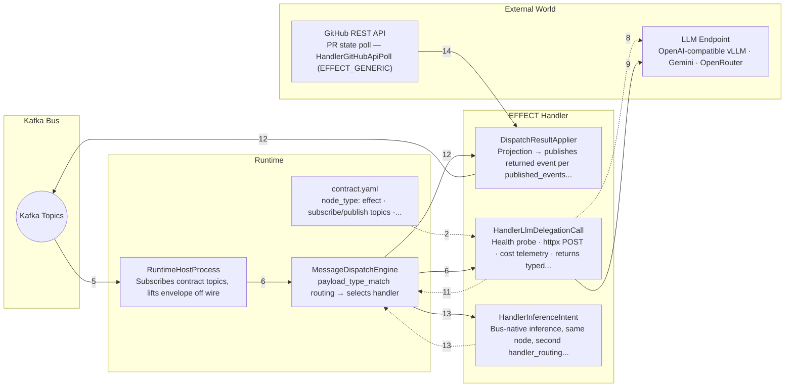

The tour, step by step:

1. The one door to the outside
2. A label, a shell, and the worker
3. Its job is written down
4. Never memorise the address
5. A request arrives in the queue
6. The sorter picks the right worker
7. The worker gets a sealed order
8. Knock before you enter
9. The actual call goes out
10. Counting the cost of the trip
11. The worker reports back, never posts itself
12. The system files the result
13. Same door, second kind of trip
14. The same pattern, a different outside system
15. The frame fits every worker


## The runtime and the loop

### Overlays

Tuning behavior by layering settings, with no code change.

Tutorial file: [`docs/tutorials/overlays.exhibit.html`](../docs/tutorials/overlays.exhibit.html) (GitHub shows its source; open it in a browser from a clone to run it)

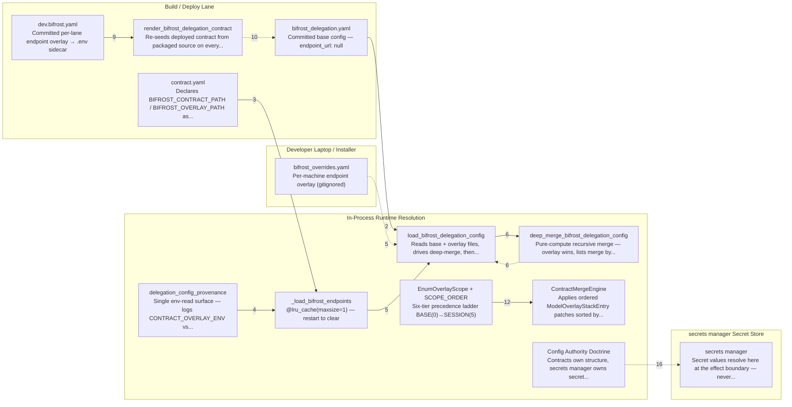

The tour, step by step:

1. One master recipe, every kitchen
2. The shared recipe leaves blanks on purpose
3. Two switches that pick which note to read
4. Always write down which note you used
5. Read both, then check the combined result
6. The note wins, and lists merge by name
7. Make sure everything still points somewhere real
8. Build the lookup once, then reuse it
9. A per-location address card, kept on the record
10. Refresh from the master copy on every restart
11. A second use: a locked door that stays shut by default
12. The permission slip points the way
13. Check the seal before the door opens
14. A clear order of who overrides whom
15. A reusable, sealed form for personal settings
16. Who is allowed to own what

### Projections & the dashboard

How results become something you can see.

Tutorial file: [`docs/tutorials/projections-dashboard.exhibit.html`](../docs/tutorials/projections-dashboard.exhibit.html) (GitHub shows its source; open it in a browser from a clone to run it)

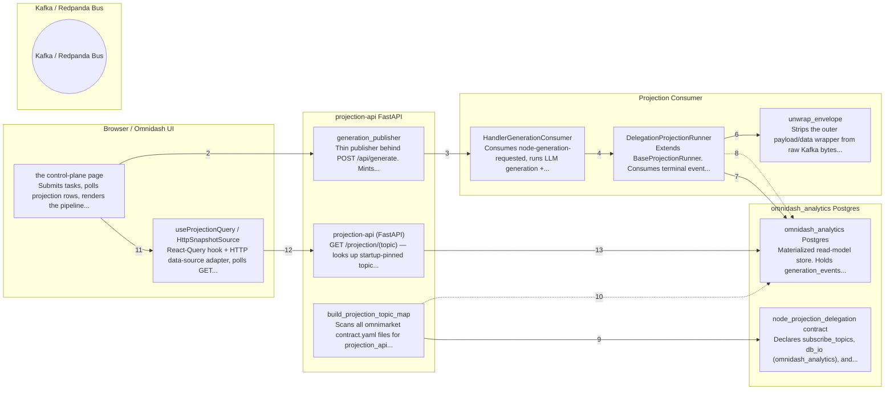

The tour, step by step:

1. Someone places an order
2. The order is written on a ticket and posted
3. The kitchen does the real cooking
4. The finished plate is set out for pickup
5. A record-keeper hears the order is ready
6. They open the package to see what's inside
7. The order is written into the order book
8. A bookmark is moved and a note posted
9. The front screen learns which book to read
10. It checks every book actually exists
11. The screen checks the book every few seconds
12. It asks the back room for the latest page
13. The back room hands back the current page
14. The result appears on the customer's screen

### Model routing & the savings ladder

Cheapest-first: try local, escalate only when needed.

Tutorial file: [`docs/tutorials/model-routing-delegation.exhibit.html`](../docs/tutorials/model-routing-delegation.exhibit.html) (GitHub shows its source; open it in a browser from a clone to run it)

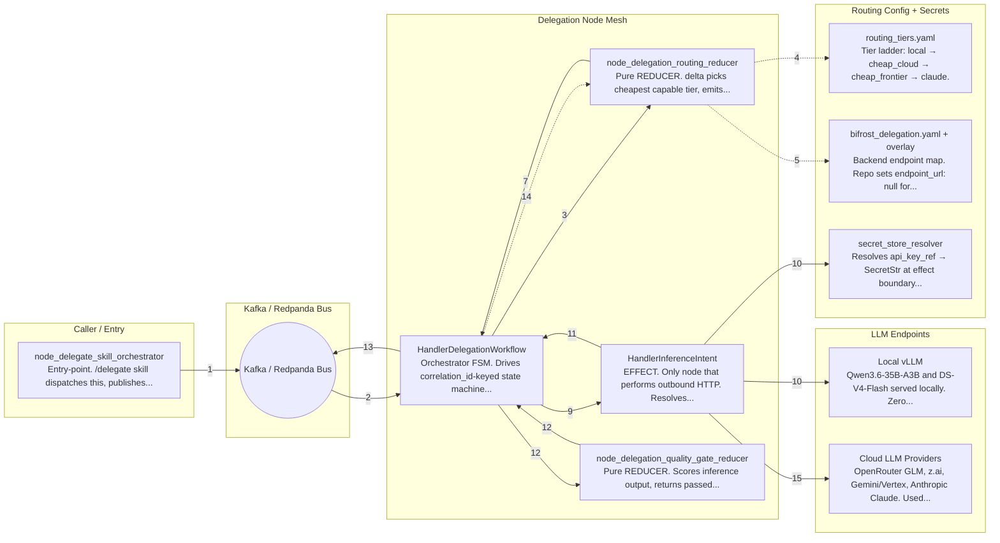

The tour, step by step:

1. Someone asks for help (topic: `onex.cmd.omnibase-infra.delegation-request.v1`)
2. A coordinator takes charge
3. Asking which helper to use (topic: `onex.cmd.omnibase-infra.delegation-routing-request.v1`)
4. Reading the menu of helpers
5. Looking up where each helper lives
6. Pick the first one that fits
7. The choice comes back (topic: `onex.evt.omnibase-infra.routing-decision.v1`)
8. Writing up the work order
9. Sending the work order out (topic: `onex.cmd.omnibase-infra.delegation-inference-request.v1`)
10. The AI is actually called
11. The answer comes back (topic: `onex.evt.omnibase-infra.inference-response.v1`)
12. Is the answer good enough?
13. It passes — and the savings are tallied
14. It fails — try a stronger helper
15. Re-running with the next helper
16. No helpers left — a clean stop


## Going deeper

### How the codebase is layered

Where a model, a protocol, or an implementation belongs.

Tutorial file: [`docs/tutorials/repo-layering.exhibit.html`](../docs/tutorials/repo-layering.exhibit.html) (GitHub shows its source; open it in a browser from a clone to run it)

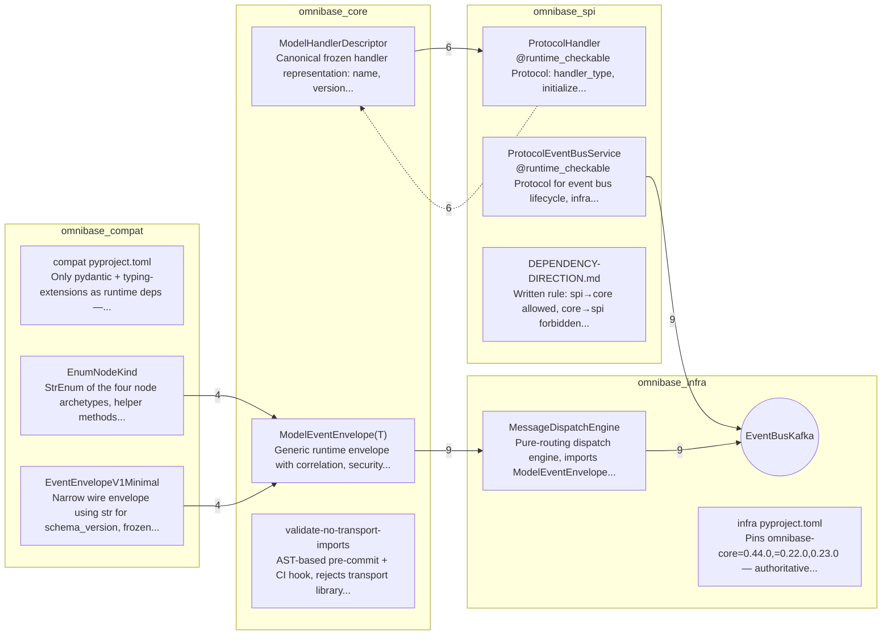

The tour, step by step:

1. A four-floor building, one-way stairs
2. The ground floor: the shared basics
3. The ground floor is temporary, with move-out dates
4. The second floor: the real vocabulary
5. A guard that won’t let heavy gear onto the second floor
6. The third floor: written job descriptions
7. The job descriptions borrow downward, never the reverse
8. Keep the shared shapes downstairs, not next to the job descriptions
9. The top floor: the parts that actually do the work
10. Workers fit the job by shape, not by paperwork
11. The top floor can reach straight down to the basics
12. Get the order wrong and the building won’t open
13. The simple rule for where anything goes
14. You can check the whole thing in two minutes

### Validators & gates

Rules enforced automatically, not by good intentions.

Tutorial file: [`docs/tutorials/validators-gates.exhibit.html`](../docs/tutorials/validators-gates.exhibit.html) (GitHub shows its source; open it in a browser from a clone to run it)

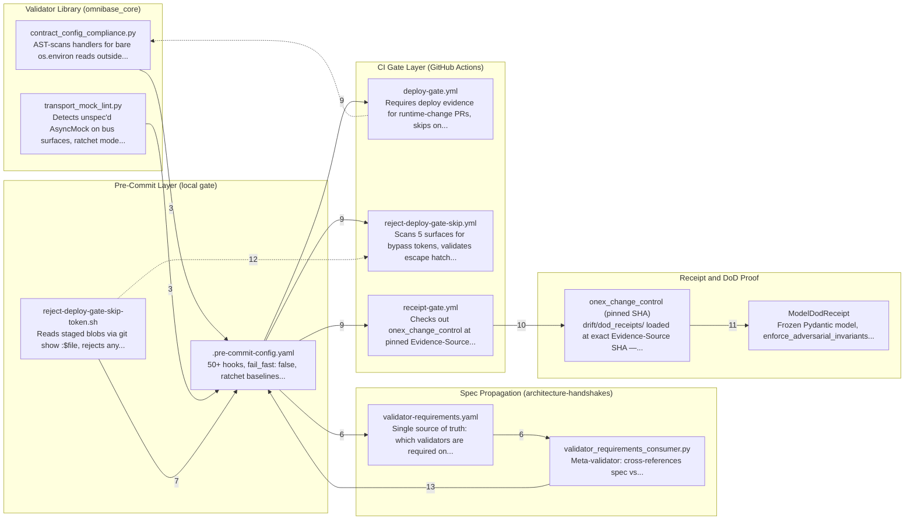

The tour, step by step:

1. Someone writes a flawed part
2. The part is dropped on the conveyor belt
3. First the part gets cleaned up
4. The inspector spots the cut corner
5. The part is sent back at the door
6. The builder fixes it the right way
7. A second guard checks for forged passes
8. Everything passes — the part ships out
9. At the shipping dock, five guards check at once
10. A guard pins the paperwork to a fixed moment
11. The proof has to survive a suspicious auditor
12. The forged-pass guard searches everywhere
13. A new rule rolls out to every workshop at once
14. For old messes, the count can only shrink
15. One last full check before it enters the warehouse

### From package to running node

How a definition on disk becomes a live, listening service.

Tutorial file: [`docs/tutorials/runtime-wiring-onex-run-node.exhibit.html`](../docs/tutorials/runtime-wiring-onex-run-node.exhibit.html) (GitHub shows its source; open it in a browser from a clone to run it)

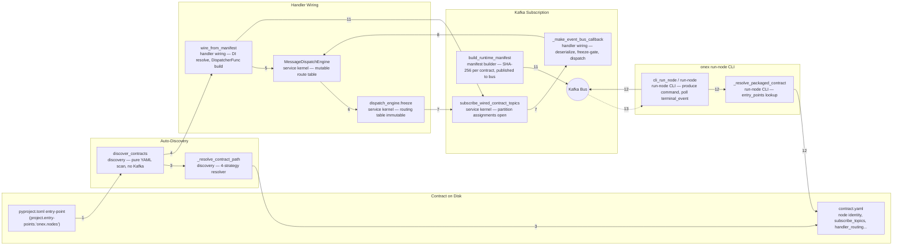

The tour, step by step:

1. A builder adds a label to the box
2. The system powers up and sets out a switchboard
3. It reads every label on the shelf
4. It keeps only the tools this job needs
5. It plugs each kept tool into the switchboard
6. It locks the wiring before turning on the power
7. It opens the doors and starts listening
8. A request arrives and gets unpacked
9. The switchboard sends it to the right tool
10. The tool does the work and hands back a result
11. It posts a list of everything that's running
12. A test request is sent in to try it out
13. The reply comes back and is printed

### Endpoint resolution

How a model name turns into a real address and key.

Tutorial file: [`docs/tutorials/endpoint-resolution-bifrost.exhibit.html`](../docs/tutorials/endpoint-resolution-bifrost.exhibit.html) (GitHub shows its source; open it in a browser from a clone to run it)

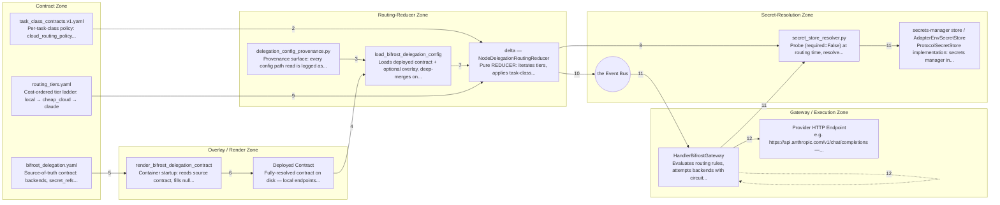

The tour, step by step:

1. The price list on the wall
2. House rules narrow the choices
3. Every lookup leaves a note
4. Combining the standard file with local tweaks
5. A public address versus a private one
6. Filling in the blanks at startup
7. A quick lookup table in memory
8. Do we even have the key for this?
9. Picking the cheapest one that fits
10. A sealed instruction with a key tag, not the key
11. The key leaves the vault only at the last moment
12. Calling the exact address, as written

### The event envelope

The wrapper that lets any run be traced and replayed.

Tutorial file: [`docs/tutorials/event-envelope-correlation.exhibit.html`](../docs/tutorials/event-envelope-correlation.exhibit.html) (GitHub shows its source; open it in a browser from a clone to run it)

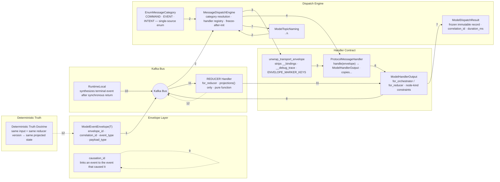

The tour, step by step:

1. A request is sealed and posted
2. The mailroom reads the label and sorts it
3. The outer wrapper is peeled off
4. The right person is found to handle it
5. The handler takes the case in hand
6. The handler hands out the next steps
7. A permanent receipt is filed
8. The same case number rides along
9. Each answer points back to its question
10. A finished stamp is added at the end
11. A clerk files the result into the ledger
12. Re-filing the same case gives the same record

### Generating new capabilities

How the platform writes new pieces of itself — held to the same rules.

Tutorial file: [`docs/tutorials/node-generation-sea.exhibit.html`](../docs/tutorials/node-generation-sea.exhibit.html) (GitHub shows its source; open it in a browser from a clone to run it)

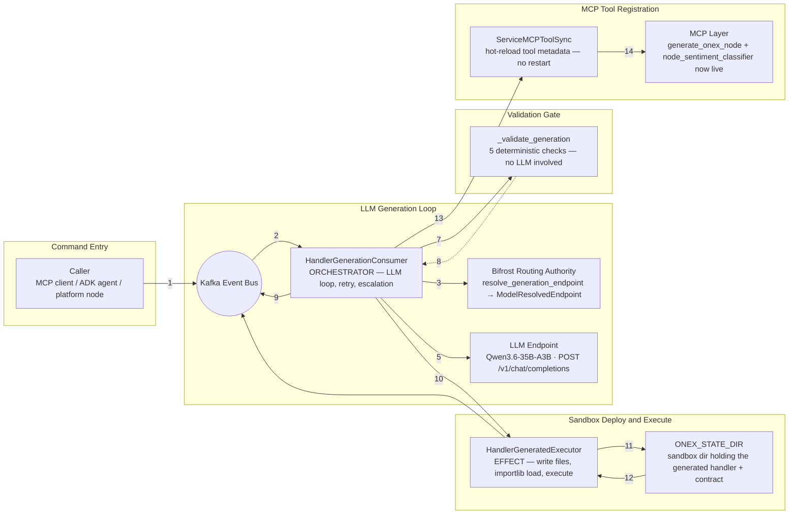

The tour, step by step:

1. Someone places an order (topic: `onex.cmd.omnimarket.node-generation-requested.v1`)
2. The workshop reads its own job sheet
3. It asks the front desk for the right address
4. It writes clear instructions for the helper
5. The request is sent to the AI helper
6. It pulls the two pieces out of the reply
7. A safety inspector checks the new part
8. If it fails, try again — or call in a better helper
9. It posts a receipt of what happened
10. It sends the part off to be installed
11. The new part is set in place
12. The new tool is switched on and tested
13. It announces the new tool to the front desk
14. The new tool is ready to use

### Skills & hooks

The boundary where a command becomes real work.

Tutorial file: [`docs/tutorials/skills-and-hooks.exhibit.html`](../docs/tutorials/skills-and-hooks.exhibit.html) (GitHub shows its source; open it in a browser from a clone to run it)

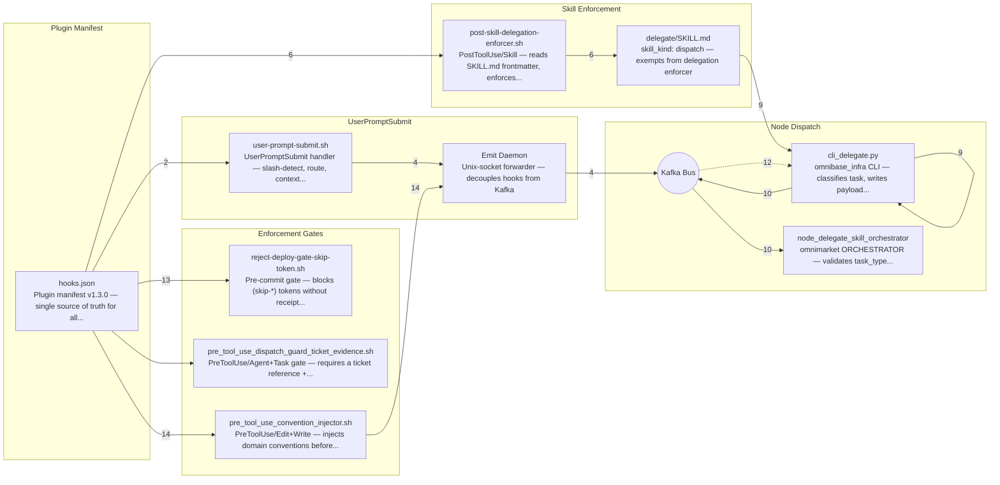

The tour, step by step:

1. You press Enter
2. A directory points to the right inspector
3. The inspector spots the shortcut
4. A note goes out, the line keeps moving (topic: `onex.evt.omniclaude.prompt-submitted.v1 — 100-char preview only; full prompt goes to onex.cmd.omniintelligence.claude-hook-event.v1`)
5. The assistant gets a helpful heads-up
6. The instructions get pulled out
7. The inspector checks the fine print
8. Cleared — handled on the spot
9. The errand is run
10. The request is sent to the back office
11. The back office double-checks and forwards
12. The answer comes back to you
13. A gatekeeper guards every save
14. Helpful house rules arrive just in time

### Sweeps & golden chains

How the system proves, end to end, that it still works.

Tutorial file: [`docs/tutorials/sweeps-and-golden-chains.exhibit.html`](../docs/tutorials/sweeps-and-golden-chains.exhibit.html) (GitHub shows its source; open it in a browser from a clone to run it)

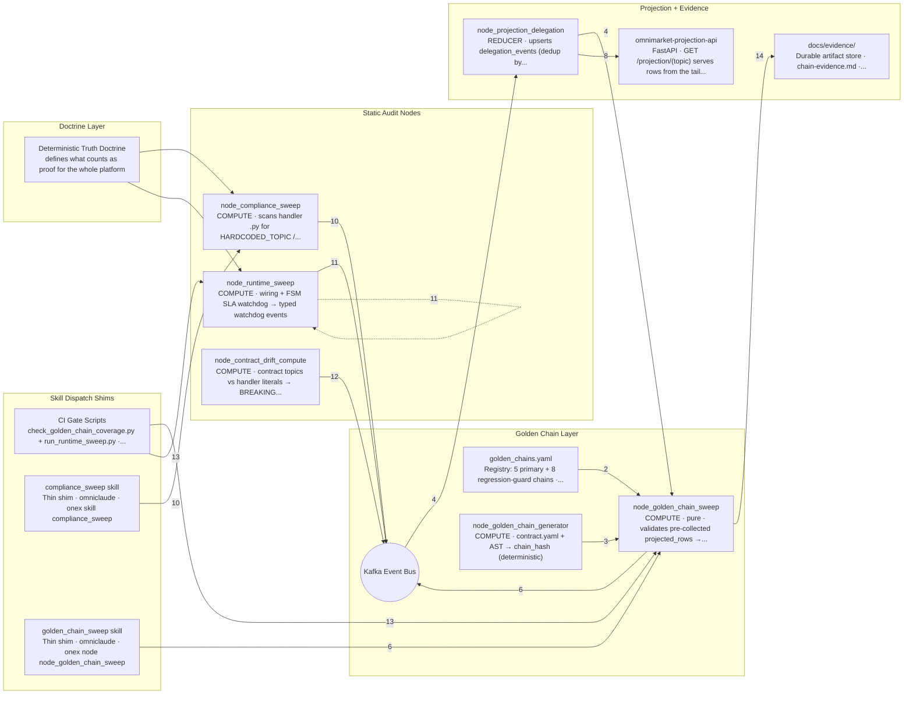

The tour, step by step:

1. What 'done' really means
2. The checklist of journeys to verify
3. Working out what a good journey looks like
4. Gathering the evidence before the check
5. The inspector compares plan to reality
6. The overall verdict
7. A real journey, all nine steps
8. Recording the final result
9. Looking up the result
10. Catching shortcuts in the work
11. Checking everything is plugged in
12. Spotting when the work drifts from its description
13. Making the checks impossible to skip
14. Keeping the proof on file


## Product surface (customer-facing)

### The Gateway

How a customer's own runtime turns a stored credential into a cloud session — and refuses when it can't prove it should.

Tutorial file: [`docs/tutorials/gateway.exhibit.html`](../docs/tutorials/gateway.exhibit.html) (GitHub shows its source; open it in a browser from a clone to run it)

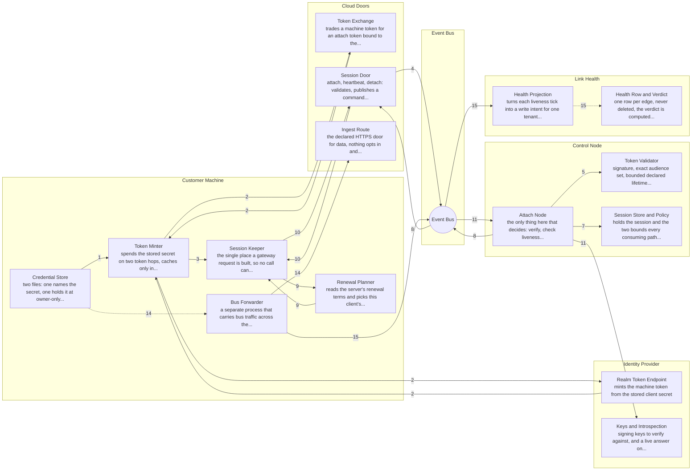

The tour, step by step:

1. The password is put somewhere it cannot be read by accident
2. Getting in takes two keys, and you only ever hold the first
3. There is exactly one way to talk to the service, and it always carries the key
4. The address you call is a receptionist, not the decision-maker (topic: `onex.cmd.omnibase-infra.gateway-attach-request.v1`, `onex.evt.omnibase-infra.gateway-session.v1`)
5. Checking the signature is the beginning, not the end
6. A valid badge is not the same as a badge that still works
7. The session has an end time, and nothing can push it back
8. The service tells you how to stay connected instead of expecting you to know
9. Everybody renews at a slightly different time, on purpose
10. Staying connected means connecting again, not asking for extra time
11. Three endings, and one thing that is not an ending
12. Your work travels on a different road than your login does
13. Some messages are turned away, and one bad message cannot block the rest
14. A door that is fully built on our side and has nothing behind it yet
15. The connection keeps a note on how it is doing, and the note is read fresh (topic: `onex.evt.omnibase-infra.gateway-heartbeat.v1`)

### Tenants & Identity

Who a request is for, and what stops one tenant's rows reaching another.

Tutorial file: [`docs/tutorials/tenants-and-identity.exhibit.html`](../docs/tutorials/tenants-and-identity.exhibit.html) (GitHub shows its source; open it in a browser from a clone to run it)

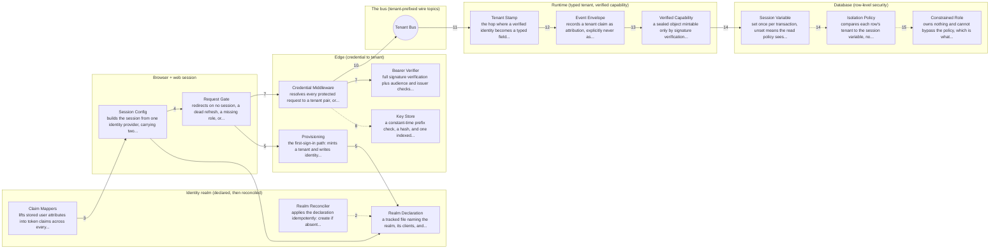

The tour, step by step:

1. The app asks who owns this data
2. The identity rules are written down, not clicked into place
3. Turning a stored profile field into part of the login token
4. The browser remembers what the token said
5. A brand-new account gets set up before it gets in
6. The customer's display name and its real identity are two different things
7. One gate decides who you are before anything else runs
8. The system never keeps a copy of your actual key
9. Typing a different name in the address bar changes nothing
10. Messages travel on a lane that only the right customer can use
11. Outside labels become a real, typed field inside
12. Saying whose event this is isn't the same as saying they're allowed
13. A special, tamper-proof pass is what actually authorizes a write
14. The database itself enforces who sees what
15. 'I don't know' is not the same as 'there's nothing'

### Delegation as a Product

How a developer buys and uses delegation — two entry surfaces, one evidence trail.

Tutorial file: [`docs/tutorials/delegation-as-a-product.exhibit.html`](../docs/tutorials/delegation-as-a-product.exhibit.html) (GitHub shows its source; open it in a browser from a clone to run it)

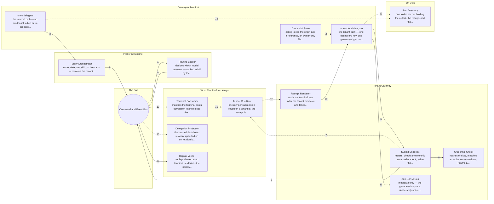

The tour, step by step:

1. There are two ways in
2. Your key lives in a file, not in your command
3. Before anything runs, the command writes down exactly what it is asking
4. The tool checks that someone is actually listening before it sends anything
5. One request leaves your machine
6. Your key is how the platform knows it is you
7. The platform records your run before it starts it
8. Both commands end up sending the same thing to the same place
9. Something picks the cheapest model that can do the job
10. The answer arrives and your run is marked finished
11. The tool waits politely instead of hammering the platform
12. You get a record of what happened, with a fingerprint
13. Every run leaves three files you keep
14. Some of the receipt can be independently checked, and some cannot

### Provider Keys by Reference

A customer's API key becomes an opaque reference the moment it enters the platform.

Tutorial file: [`docs/tutorials/provider-keys-by-reference.exhibit.html`](../docs/tutorials/provider-keys-by-reference.exhibit.html) (GitHub shows its source; open it in a browser from a clone to run it)

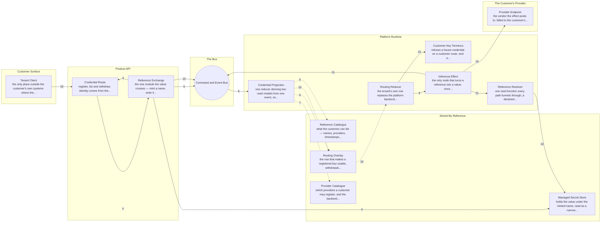

The tour, step by step:

1. You hand over a key, once
2. The platform knows who you are before it does anything
3. Only providers we can actually route are accepted
4. Your key is swapped for a name
5. What travels is a name, not a key (topic: `onex.evt.omnimarket.credential-registered.v1`)
6. Registering a key also makes it usable, in one step
7. An unknown provider gets no route at all
8. When you delegate, the platform looks up your own route
9. Your route is yours, end to end
10. The platform refuses rather than quietly using its own key
11. The key is fetched once, right before the call
12. The part of the platform that reads keys can barely do anything else
13. If the key cannot be found, the request stops
14. Your key is used, then forgotten
15. Removing a key stops your work, rather than silently switching it (topic: `onex.evt.omnimarket.credential-revoked.v1`)
16. Someone actually runs all of this, end to end, and grades it

### onex-api: Reader & Writer

How the HTTP boundary reads a projection and writes a command — never a row.

Tutorial file: [`docs/tutorials/onex-api-projection-reader.exhibit.html`](../docs/tutorials/onex-api-projection-reader.exhibit.html) (GitHub shows its source; open it in a browser from a clone to run it)

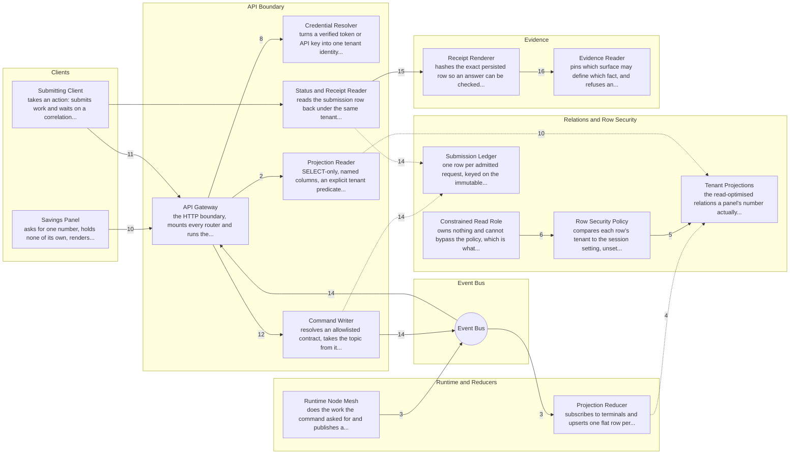

The tour, step by step:

1. The screen asks a question
2. The total is stored, not calculated on demand
3. Someone else filled the table in (topic: `onex.evt.omnibase-infra.delegation-completed.v1`, `onex.evt.omnibase-infra.delegation-failed.v1`)
4. Each row had to learn whose it is
5. The database itself enforces who sees what
6. Who you log in as decides whether the rules apply
7. Two halves of the system used different names for the same customer
8. You cannot ask for someone else's data
9. The customer's identity is stated twice, on purpose
10. 'I have no rows' and 'that table does not exist' are different answers
11. Asking for work is not the same as doing it
12. The caller cannot choose where their request goes (topic: `onex.cmd.omnibase-infra.delegation-request.v1`)
13. When a check cannot run, the answer is no
14. You get a receipt number, not an answer
15. A tamper-evident summary of one job
16. Knowing when you do not know


## Delivery and change control

### The Delivery Chain: Lab to Production

How a merged commit becomes running software, gated by a sha-keyed lab-pass receipt.

Tutorial file: [`docs/tutorials/delivery-chain-lab-to-prod.exhibit.html`](../docs/tutorials/delivery-chain-lab-to-prod.exhibit.html) (GitHub shows its source; open it in a browser from a clone to run it)

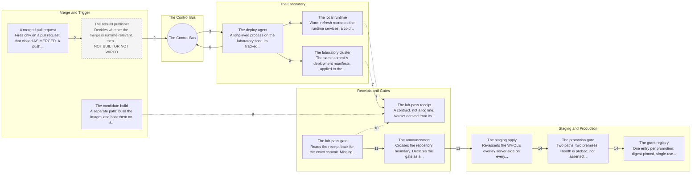

The tour, step by step:

1. It starts when a change is accepted
2. One message goes out, and that is all (topic: `onex.cmd.omnimarket.redeploy-start.v1`)
3. A machine in the lab is listening
4. The lab rebuilds itself with the new version
5. The lab also tries the real packaging
6. Someone checks it actually happened
7. The result is written down in a fixed form
8. The form itself rejects nonsense
9. A throwaway copy is stood up from scratch
10. Before anything moves on, the proof is checked
11. There is no button to skip the check
12. The receiving side checks for itself
13. The shared environment is rewritten, not edited
14. Only production needs a person to say yes
15. There is no single thing called 'already tested'
16. What this still cannot tell you

What the tutorial says is not built:

- Three probes that would widen the container-lane receipt need database or broker access the emitting job does not have, and are listed BY NAME as not yet wired — widening means adding the probe AND the check name in one change, never the...

### Change Control End to End

How a ticket is proven complete by machine, not by a checked box.

Tutorial file: [`docs/tutorials/change-control-end-to-end.exhibit.html`](../docs/tutorials/change-control-end-to-end.exhibit.html) (GitHub shows its source; open it in a browser from a clone to run it)

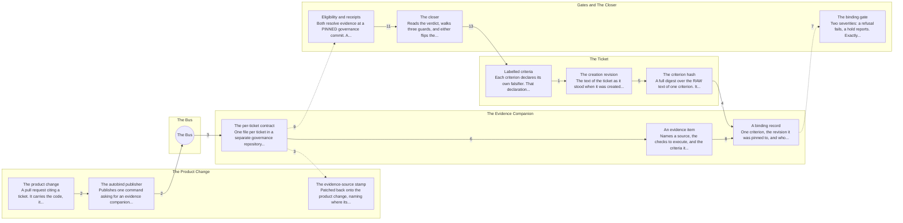

The tour, step by step:

1. Say up front what would prove you wrong
2. The change requests its own paperwork (topic: `onex.cmd.omnimarket.occ-autobind.v1`)
3. The paperwork is created automatically
4. The record copies the author, it does not decide
5. A fingerprint of the exact wording
6. Each piece of proof says how to test it
7. Some problems stop you, others are just noted
8. The tests are run, not just listed
9. Every test needs a signed result on file
10. The paperwork lands before the change
11. A separate process decides what is finished
12. A full set of ticks is still not enough
13. One final check before anything is marked done
14. The 'no's are the whole point
15. What it still cannot tell you

### Secrets & Configuration

How a node gets its URLs, config and keys when none of them live in the environment.

Tutorial file: [`docs/tutorials/secrets-and-configuration.exhibit.html`](../docs/tutorials/secrets-and-configuration.exhibit.html) (GitHub shows its source; open it in a browser from a clone to run it)

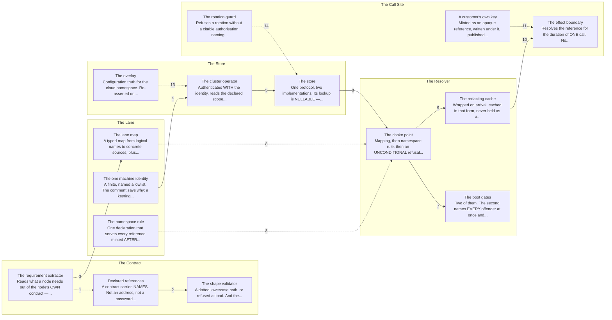

The tour, step by step:

1. The setup file holds labels, not passwords
2. Pasting a real key there is rejected
3. Each environment says where its values come from
4. One key, and only one, is kept on the machine
5. In the cloud, a helper fetches on your behalf
6. Which source wins depends on the environment
7. If something is missing, it does not start
8. Every lookup goes through one door
9. The value is wrapped so it cannot be printed
10. The real value appears only at the point of use
11. A customer's key follows the same route in reverse
12. A customer's traffic never runs on our account
13. The files decide, not whatever is running
14. Changing a key needs written permission first
15. What is actually enforced, and what is just policy


## Operations

### CI on the Fleet

How a pushed branch's checks land on a machine, and which contexts can actually block a merge.

Tutorial file: [`docs/tutorials/ci-on-the-fleet.exhibit.html`](../docs/tutorials/ci-on-the-fleet.exhibit.html) (GitHub shows its source; open it in a browser from a clone to run it)

```mermaid
flowchart LR
  subgraph z0["The Change"]
    n0["A pushed branch<br/>One branch from a per-ticket worktree. No job has a machine..."]
    n1["a job's runs-on expression<br/>A chain of fallbacks, not a machine name. You cannot answer..."]
  end
  subgraph z1["Routing Authority"]
    n2["the narrower routing variables<br/>Container jobs, the security scan, the fork branch, the..."]
    n3["the trusted-CI seam variable<br/>One name, several scopes. A repository value silently wins..."]
    n4["the routing policy file<br/>Asserted intent: what each variable should hold, where, and..."]
    n5["the hourly routing audit<br/>Compares live variables and parsed workflows against the..."]
  end
  subgraph z2["Compute"]
    n6["the per-run route job<br/>Second decision: does the chosen pool have room right now?"]
    n7["the self-hosted fleet<br/>Declared in one file: runner group, host, name prefix..."]
    n8["hosted runners<br/>Where a fork pull request goes on purpose, plus a..."]
  end
  subgraph z3["Gates That Can Block"]
    n9["the summary umbrella<br/>Polls the run and computes one fail-closed verdict. On some..."]
    n10["the receipt gate<br/>Reads the pull request body, extracts a ticket, checks the..."]
    n11["the deploy gate<br/>Does this change need a deploy, and is the deploy evidence..."]
    n12["the external-context tuple<br/>The list the umbrella asserts on. A context missing from it..."]
  end
  subgraph z4["Landing"]
    n13["required contexts<br/>The first enforcement surface. Read required as can block..."]
    n14["the bulk throttle<br/>Waves many pull requests in batches against a queue-depth..."]
  end
  n0 -->|"1"| n1
  n1 -->|"2"| n2
  n1 -->|"2"| n3
  n4 -.->|"6"| n5
  n5 -->|"6"| n3
  n3 -->|"7"| n6
  n6 -->|"8"| n7
  n2 -->|"9"| n8
  n7 -->|"10"| n9
  n8 -->|"10"| n9
  n10 -.->|"11"| n12
  n11 -.->|"12"| n12
  n9 -->|"13"| n12
  n12 -->|"13"| n13
  n13 -.->|"14"| n14
```

The tour, step by step:

1. Someone pushes a change
2. A list of preferences, in order
3. Some jobs have their own rule
4. A local setting beats the global one
5. Write down what it is supposed to be
6. An hourly check that the settings still match the plan
7. Is there actually a free machine?
8. It runs on our own machines
9. Outside contributions run somewhere safe
10. One summary that speaks for all the checks
11. Show your work
12. Did you say how this ships?
13. Two different ways a check can stop you
14. Merging, and not all at once

### The Ledger and the Lanes

How dozens of concurrent agent lanes claim, place and commit work without colliding.

Tutorial file: [`docs/tutorials/ledger-and-lanes.exhibit.html`](../docs/tutorials/ledger-and-lanes.exhibit.html) (GitHub shows its source; open it in a browser from a clone to run it)

```mermaid
flowchart LR
  subgraph z0["The Lane"]
    n0["the lane rules block<br/>A scope, a ticket, and the standing rules — repeated per..."]
    n1["a lane<br/>An independent agent. No shared memory with any peer, no..."]
  end
  subgraph z1["The Ledger"]
    n2["the rolling work ledger<br/>Append-only coordination state. Thousands of rows, with..."]
    n3["the append tool<br/>The only sanctioned writer. Takes a mutex, validates..."]
    n4["the directory mutex<br/>An atomic directory creation, because this platform has no..."]
    n5["the row guards<br/>Refuse a malformed or unaccompanied row before it lands..."]
  end
  subgraph z2["Placement"]
    n6["the placement guard<br/>Inspects a checkout command before it runs and refuses one..."]
    n7["a per-ticket checkout<br/>The normal case. One checkout per ticket means two lanes..."]
    n8["the one shared tree<br/>The exception: the coordination surfaces themselves..."]
  end
  subgraph z3["The Commit Mutex"]
    n9["the commit wrapper<br/>One exclusive lock across the WHOLE stage-and-commit..."]
    n10["the shared index<br/>Collision class one: two lanes race it, and the loser..."]
    n11["the check-only hooks<br/>Collision class two lives here. Every hook in this..."]
    n12["the two refusals<br/>A split path, and foreign staged paths. Both are a peer's..."]
  end
  subgraph z4["Admission and Close"]
    n13["the admission guard<br/>A lane cannot mint its own backlog: no orphan tickets."]
    n14["the closing row<br/>Closes the claim, naming the lane, the claim, the ticket..."]
  end
  n0 -->|"1"| n1
  n1 -.->|"2"| n2
  n1 -->|"3"| n3
  n3 -->|"4"| n4
  n3 -->|"5"| n5
  n3 -->|"5"| n2
  n5 -->|"6"| n6
  n6 -->|"6"| n7
  n6 -->|"8"| n8
  n9 -->|"9"| n10
  n9 -->|"10"| n11
  n8 -->|"12"| n9
  n9 -->|"13"| n12
  n12 -->|"14"| n13
  n13 -->|"15"| n14
  n14 -.->|"15"| n2
```

The tour, step by step:

1. One worker starts, alone
2. Check whether someone is already on it
3. Say what you are doing, and what you are not
4. One writer at a time
5. The notebook has rules about what you may write
6. Each job gets its own copy of the code
7. Stopped before the mistake, not after
8. Except for one shared place
9. Two workers reach for the same drawer
10. Automatic tidying that tidies the wrong desk
11. Accidentally filing somebody else's paperwork
12. Take the whole desk, not just the drawer
13. When in doubt, stop and ask
14. You cannot give yourself more work
15. Sign off, and admit what is still unsolved

What the tutorial says is not built:

- what would close it: per-file edit leases — a follow-up, not built

### Evals & the Context Service

How the platform judges a cheaper model's work — and the context layer that isn't wired yet.

Tutorial file: [`docs/tutorials/evals-and-context-service.exhibit.html`](../docs/tutorials/evals-and-context-service.exhibit.html) (GitHub shows its source; open it in a browser from a clone to run it)

```mermaid
flowchart LR
  subgraph z0["The Task"]
    n0["the delegation request<br/>A prompt and a task type. No model named. Three files..."]
    n1["the task class contract<br/>Declares what acceptable means, and how far escalation may..."]
  end
  subgraph z1["Context — Built, Not Wired"]
    n2["the context assembler<br/>BUILT, NO CALLER. Real, deterministic, tested — and nothing...<br/>NOT BUILT OR NOT WIRED"]
    n3["the context receipt field<br/>BUILT, UNINFORMATIVE. Present on every row, empty on every...<br/>NOT BUILT OR NOT WIRED"]
    n4["the ingestion family<br/>BUILT, ONE OF TWELVE WIRED. The writer targets tables...<br/>NOT BUILT OR NOT WIRED"]
  end
  subgraph z2["The Run"]
    n5["the tier ladder<br/>Four tiers in escalation order. Three of them evaluate..."]
    n6["the routing reducer<br/>Takes the first tier that is capable AND reachable. Pure..."]
    n7["the inference call<br/>The one node touching a provider. Health cache..."]
  end
  subgraph z3["Judgement"]
    n8["the quality gate<br/>Four fields, not a verdict: passed, a score, the reasons..."]
    n9["the grounding check<br/>Were the identifiers the model cited actually in the prompt..."]
    n10["the escalation decision<br/>Escalate or stop, as its own node with typed inputs and its..."]
  end
  subgraph z4["Measurement"]
    n11["the task bundles<br/>Twenty-eight committed tasks across seven rungs. Fixed..."]
    n12["the ladder runner<br/>TWO ARMS, NEITHER IS CONTEXT. No arm, variant or condition..."]
    n13["the context experiment<br/>BUILT, NEVER RUN. Three nodes, zero recorded results.<br/>NOT BUILT OR NOT WIRED"]
    n14["the two plan documents<br/>PROPOSED. Each labels its own status in its own header...<br/>NOT BUILT OR NOT WIRED"]
  end
  n0 -->|"2"| n1
  n1 -->|"3"| n6
  n0 -.->|"4"| n2
  n2 -.->|"5"| n3
  n4 -.->|"6"| n2
  n6 -->|"7"| n5
  n6 -->|"8"| n7
  n7 -->|"9"| n8
  n8 -->|"10"| n9
  n8 -->|"11"| n10
  n10 -->|"11"| n6
  n11 -->|"12"| n12
  n10 -->|"12"| n11
  n12 -.->|"13"| n13
  n13 -.->|"15"| n14
  classDef notbuilt stroke-dasharray: 5 4,fill:#f4f4f4,color:#555;
  class n2,n3,n4,n13,n14 notbuilt;
```

The tour, step by step:

1. A cheap answer only counts if it is right
2. Say what you need, not who should do it
3. Different kinds of work get different rules
4. The part that gathers background is not switched on
5. A box that is always filled in the same way
6. The library is built and nobody stocked it
7. Try the cheap one first, if it can actually be reached
8. One place talks to the outside world
9. Not just pass or fail
10. Did it make that up?
11. Try again, or stop here
12. To compare, keep the questions the same
13. The experiment is missing its main variable
14. It was built, and never switched on
15. Five things stand between here and an answer

What the tutorial says is not built:

- status: PROPOSED — the arm is designed in a plan, not built


## How done is proven

### OCC, DoD and SEA: how the platform proves work is done

One real task followed from the contract that says what done means, through the proof run and the receipt, to the gate that will not merge without it. Dashed arrows are the capability-generation path.

Tutorial file: [`docs/tutorials/occ-dod-sea-ideal-flow.html`](../docs/tutorials/occ-dod-sea-ideal-flow.html) (GitHub shows its source; open it in a browser from a clone to run it)

```mermaid
flowchart LR
  subgraph z_ticket["ticket and done contract"]
    linear["Ticket<br/>the task, in Linear"]
    central["Done contract<br/>one contract per ticket"]
  end
  subgraph z_product["implementation"]
    worktree["Worktree<br/>isolated copy of the repo"]
    repoContract["Deploy contract<br/>one input to the gate"]
  end
  subgraph z_occ["evidence (OCC)"]
    proofRun["Tests and probes<br/>run them, watch the output"]
    receipt["PASS receipt<br/>durable record of the run"]
  end
  subgraph z_gate["gates and merge"]
    prBody["Pull request<br/>cites the ticket + proof"]
    receiptGate["Receipt Gate<br/>checks the proof is real"]
    merge["Merge + closeout<br/>green gate, clean tree"]
  end
  subgraph z_sea["generating capabilities"]
    seaIntent["Capability request<br/>a ticket, like any other"]
    genContract["Generated node<br/>contract + handler + models"]
    validator["Validators<br/>non-AI admissibility checks"]
  end
  subgraph z_runtime["runtime truth"]
    eventLog["Event log<br/>the shared, ordered bus"]
    projection["Projection<br/>a table of current state"]
    dashboard["Read surface<br/>dashboard reads the projection"]
  end
  shape["Deterministic shape<br/>same inputs + contract → same state"]
  linear --> central
  central --> worktree
  worktree --> repoContract
  worktree --> proofRun
  proofRun --> receipt
  receipt --> central
  central --> prBody
  receipt --> receiptGate
  prBody --> receiptGate
  receiptGate --> merge
  central -.-> seaIntent
  seaIntent -.-> genContract
  genContract -.-> validator
  validator --> eventLog
  eventLog --> projection
  projection --> dashboard
  validator --> shape
  projection --> shape
```

The tour, step by step:

1. Done is written down before any code
2. The code changes in an isolated worktree
3. Proof is something you can run and watch
4. The result is saved as a receipt the system can re-read
5. The pull request points at the ticket and its proof
6. The gate only opens for real, passing proof
7. Done means a clean merge and a clean workspace
8. The same rules apply when the platform writes its own code
9. Generated code passes the same automatic checks
10. Running work leaves an event trail, not hidden state
11. The dashboard reads the number, it doesn't invent it
12. Done is a shape the platform can re-check on its own


## Repository tours

Each repository tour is a guided walk through what one repository contains. The diagram shows the repository and the modules the tour visits, numbered in tour order. The arrows mean "contains", not "depends on"; for how the repositories depend on each other, see the Repo Layering diagram above.

### OmniNode Knowledge Base

Public, validation-gated architectural provenance repo: doctrine, ADRs, TDDs, pivots, deep-dives, experiments, evidence and plans, with a Pydantic frontmatter schema and a sanitization gate keeping the public record clean.

Tour file: [`docs/tutorials/knowledge-base.html`](../docs/tutorials/knowledge-base.html) (GitHub shows its source; open it in a browser from a clone to run it)

```mermaid
flowchart TB
  root["OmniNode Knowledge Base"]
  n0["1 Validator CLI<br/>runs the five artifact checks"]
  root --> n0
  n1["2 Forbidden-pattern source<br/>shared private-content regex list"]
  root --> n1
  n2["3 Commit and PR text gate<br/>blocks leaks in messages and titles"]
  root --> n2
  n3["4 Index generator<br/>regenerates the artifact indexes"]
  root --> n3
  n4["5 Architecture TDD<br/>the accepted platform design"]
  root --> n4
  n5["6 CI workflow<br/>validate + sanitize-text jobs"]
  root --> n5
  n6["7 Pre-commit config<br/>wires the commit-msg hook"]
  root --> n6
  n7["8 Frontmatter JSON schema<br/>exported discriminated-union schema"]
  root --> n7
```

The tour, step by step:

1. The library of decisions
2. The librarian who checks every entry
3. The list of things that must never be made public
4. The guard on outgoing messages
5. The catalog that stays current by itself
6. The master plan everyone agrees on
7. The checkpoint before anything is published
8. Catching problems before they leave your desk
9. The official template for every heading
10. How it all fits together

### omnibase_compat — cross-repo structural compatibility shim

A temporary, zero-upstream-dependency package that owns stable enums, wire DTOs, and event envelopes shared across OmniNode repos without creating an import cycle through core/spi/infra.

Tour file: [`docs/tutorials/omnibase_compat.html`](../docs/tutorials/omnibase_compat.html) (GitHub shows its source; open it in a browser from a clone to run it)

```mermaid
flowchart TB
  root["omnibase_compat — cross-repo structural compatibility shim"]
  n0["1 event envelope<br/>minimal cross-repo envelope"]
  root --> n0
  n1["2 project-tracker models<br/>frozen wire DTOs"]
  root --> n1
  n2["3 enums<br/>provenance-tracked StrEnum copies"]
  root --> n2
  n3["4 contracts<br/>domain wire DTOs"]
  root --> n3
  n4["5 overseer<br/>routing decisions and agent scopes"]
  root --> n4
  n5["6 routing + telemetry<br/>policy and telemetry DTOs"]
  root --> n5
  n6["7 protocols + adapters<br/>cross-repo protocols and adapter"]
  root --> n6
  n7["8 experimental registry<br/>in-memory artifact registry"]
  root --> n7
  n8["9 upstream-dep validator<br/>AST import-boundary scan"]
  root --> n8
  n9["10 infra-edge checker<br/>dependency-closure scan"]
  root --> n9
  n10["11 retention checker<br/>migration-metadata enforcer"]
  root --> n10
```

The tour, step by step:

1. A shared shelf of common parts
2. A standard shipping label for messages
3. Ready-made forms for project tracking
4. A shared list of allowed words
5. Order forms for the system's main jobs
6. The rules for who handles what
7. The settings and progress notes for routing
8. Shared plugs and a translator
9. A scratch pad for experiments
10. A guard that blocks the wrong neighbors
11. A second guard, checking the fine print
12. An expiry-date checker
13. How it all fits — and the one warning

### omnibase_core — the platform kernel

The platform kernel: owns the four node archetypes, contracts, core Pydantic models, and the validation tooling that downstream OmniNode repos consume.

Tour file: [`docs/tutorials/omnibase_core.html`](../docs/tutorials/omnibase_core.html) (GitHub shows its source; open it in a browser from a clone to run it)

```mermaid
flowchart TB
  root["omnibase_core — the platform kernel"]
  n0["1 nodes<br/>the four node base classes"]
  root --> n0
  n1["2 runtime<br/>handler registry + message dispatch"]
  root --> n1
  n2["3 protocols (message handler)<br/>the handler contract every handler implements"]
  root --> n2
  n3["4 models/dispatch ModelHandlerOutput<br/>per-archetype, validated handler output"]
  root --> n3
  n4["5 container DI<br/>dependency-injection container"]
  root --> n4
  n5["6 infrastructure/infra_bases<br/>pre-composed service wrappers"]
  root --> n5
  n6["7 validation<br/>core-owned validators as console scripts"]
  root --> n6
  n7["8 cli<br/>the stable external CLI surface"]
  root --> n7
  n8["9 topics.py<br/>canonical wire-format topic names"]
  root --> n8
  n9["10 doctor<br/>extensible health-check registry"]
  root --> n9
```

The tour, step by step:

1. The shared rulebook everyone follows
2. The standard kinds of worker
3. The dispatcher that routes each request
4. The single job description every worker signs
5. The receipt each worker must hand back
6. The supply room that hands out tools
7. The ready-made starter kits
8. The inspectors that keep everyone honest
9. The control panel people actually use
10. The master list of addresses
11. The self-checkup tool
12. How it all fits together

### omnibase_infra — Infrastructure Runtime

The infrastructure implementation layer of the platform: a single-process runtime host that loads contract-declared nodes, routes Kafka events through a message dispatch engine, and performs all external I/O behind handlers — depends on omnibase_core (models)...

Tour file: [`docs/tutorials/omnibase_infra.html`](../docs/tutorials/omnibase_infra.html) (GitHub shows its source; open it in a browser from a clone to run it)

```mermaid
flowchart TB
  root["omnibase_infra — Infrastructure Runtime"]
  n0["1 RuntimeHostProcess / service kernel<br/>boots and runs every node in one process"]
  root --> n0
  n1["2 MessageDispatchEngine<br/>matches each event to its handler and fans out"]
  root --> n1
  n2["3 HandlerPluginLoader<br/>discovers and loads handlers from contract YAML"]
  root --> n2
  n3["4 Event bus (Kafka + in-memory)<br/>the transport carrying events between nodes"]
  root --> n3
  n4["5 Nodes (4 archetypes)<br/>the declarative units of work the runtime hosts"]
  root --> n4
  n5["6 Shared handlers<br/>where external I/O actually happens"]
  root --> n5
  n6["7 Config discovery + secrets manager prefetch<br/>resolves secrets and config at startup"]
  root --> n6
  n7["8 Service catalog + onex CLI<br/>declares services and the operator command line"]
  root --> n7
  n8["9 Error hierarchy<br/>typed, sanitized errors for every transport"]
  root --> n8
```

The tour, step by step:

1. Meet the engine room
2. The part that starts everything
3. The switchboard
4. Hiring the right workers
5. The conveyor belt
6. The catalog of workers
7. Where the system touches the outside world
8. Fetching the keys at startup
9. The control room and its dials
10. When something goes wrong
11. How it all fits together

### omnibase_spi — the protocol boundary layer

Service Provider Interface package: 231 runtime-checkable Python Protocol contracts across 39 domains plus narrow data-only wire contracts that implementation repos (omnibase_infra, product repos) satisfy, while importing shared models from omnibase_core.

Tour file: [`docs/tutorials/omnibase_spi.html`](../docs/tutorials/omnibase_spi.html) (GitHub shows its source; open it in a browser from a clone to run it)

```mermaid
flowchart TB
  root["omnibase_spi — the protocol boundary layer"]
  n0["1 protocols/<br/>runtime-checkable protocol boundaries"]
  root --> n0
  n1["2 protocols/runtime/<br/>in-process runtime resolution contracts"]
  root --> n1
  n2["3 protocols/event_bus/<br/>distributed messaging transport contracts"]
  root --> n2
  n3["4 contracts/<br/>frozen data-only wire payloads"]
  root --> n3
  n4["5 effects/<br/>synchronous effect boundary helpers"]
  root --> n4
  n5["6 exceptions.py<br/>SPI exception hierarchy from SPIError"]
  root --> n5
  n6["7 enums/ + factories/ + registry/<br/>dependency-free enums, factories, registry helpers"]
  root --> n6
  n7["8 scripts/validation/<br/>repo-local shape and naming validators"]
  root --> n7
```

The tour, step by step:

1. A rulebook of standard plugs
2. The full catalog of standard shapes
3. Plugs for parts on the same machine
4. Plugs for parts that talk across the network
5. Sealed shipping labels for data in transit
6. Plugs for parts that touch the outside world
7. A shared family of warning labels
8. A tidy box of shared small parts
9. The inspectors that enforce the rules
10. How it all fits — and what to watch for

### omniclaude — Claude Code plugin layer for the platform

Thin Claude Code plugin (hooks, agent routing, skill/agent definitions, hook payload models) that connects Claude Code sessions to the Runtime, all business logic lives in omnimarket nodes.

Tour file: [`docs/tutorials/omniclaude.html`](../docs/tutorials/omniclaude.html) (GitHub shows its source; open it in a browser from a clone to run it)

```mermaid
flowchart TB
  root["omniclaude — Claude Code plugin layer for the platform"]
  n0["1 Lifecycle hooks<br/>hook registration manifest"]
  root --> n0
  n1["2 Hook scripts<br/>per-event shell entrypoints"]
  root --> n1
  n2["3 Hook handler library<br/>Python hook logic modules"]
  root --> n2
  n3["4 Event schemas<br/>frozen hook payload models"]
  root --> n3
  n4["5 TopicBase enum<br/>canonical wire-topic names"]
  root --> n4
  n5["6 Agent definitions<br/>per-domain agent configs"]
  root --> n5
  n6["7 Skills<br/>thin UX dispatch triggers"]
  root --> n6
  n7["8 Nodes<br/>node dirs holding skill logic"]
  root --> n7
  n8["9 Contracts<br/>per-ticket contract declarations"]
  root --> n8
  n9["10 Plugin marketplace manifest<br/>marketplace install declaration"]
  root --> n9
```

The tour, step by step:

1. The kit of parts
2. Tripwires that notice what you do
3. The quick doorbell press
4. The brains behind the tripwires
5. Fixed forms for the notes it sends
6. The official address book
7. A roster of specialists
8. One-tap shortcuts
9. Where the real work lives
10. Written agreements
11. The install card
12. How it all fits — and what to watch

### OmniDash — Composable Widget Dashboard

A Vite + React 19 single-page app that discovers, mounts, and arranges self-contained per-widget components in a drag-and-drop grid, widgets render projection/API truth and never own backend state.

Tour file: [`docs/tutorials/omnidash.html`](../docs/tutorials/omnidash.html) (GitHub shows its source; open it in a browser from a clone to run it)

```mermaid
flowchart TB
  root["OmniDash — Composable Widget Dashboard"]
  n0["1 App shell / FrameLayout<br/>top-level shell + routing"]
  root --> n0
  n1["2 Component Registry generator<br/>builds the registry manifest"]
  root --> n1
  n2["3 Widget lazy-import map<br/>key → widget loader"]
  root --> n2
  n3["4 Data-source factory<br/>picks the backend adapter"]
  root --> n3
  n4["5 Data-source override seam<br/>resolves the effective backend"]
  root --> n4
  n5["6 Contract-owned data-source defaults<br/>generated default mode"]
  root --> n5
  n6["7 Zustand store slices<br/>frame-level UI state"]
  root --> n6
  n7["8 Schema types<br/>shared schema types"]
  root --> n7
  n8["9 Express bridge server<br/>HTTP projection bridge"]
  root --> n8
  n9["10 Conversational agent<br/>dashboard-builder agent"]
  root --> n9
  n10["11 Services route seam<br/>single API-call home"]
  root --> n10
```

The tour, step by step:

1. A wall of pinnable cards
2. The frame that holds everything
3. The catalog of available cards
4. Fetching a card only when needed
5. Choosing where the data comes from
6. One place that settles the question
7. The sensible default, written down
8. The shared memory of the moment
9. The agreed-upon shapes
10. The pipe to live information
11. The assistant that builds for you
12. All the outside requests in one spot
13. How the pieces fit, and what to watch for

### OmniIntelligence: the Intelligence Platform

Pattern learning, code-quality scoring, intent classification, evaluation, and Claude Code hook processing delivered as 59 first-class Nodes (thin-shell node.py + handler modules) wired onto Kafka by a contract-driven dispatch engine.

Tour file: [`docs/tutorials/omniintelligence.html`](../docs/tutorials/omniintelligence.html) (GitHub shows its source; open it in a browser from a clone to run it)

```mermaid
flowchart TB
  root["OmniIntelligence: the Intelligence Platform"]
  n0["1 Node registry (59 entry points)<br/>package entry-point manifest"]
  root --> n0
  n1["2 PluginIntelligence<br/>domain plugin bootstrap sequence"]
  root --> n1
  n2["3 Intelligence dispatch engine<br/>builds and registers the dispatch engine"]
  root --> n2
  n3["4 Contract-driven topic discovery<br/>reads topics from node contracts"]
  root --> n3
  n4["5 NodeClaudeHookEventEffect<br/>ingests Claude Code hook events"]
  root --> n4
  n5["6 Pattern store adapter<br/>persists learned patterns to Postgres"]
  root --> n5
  n6["7 Pattern query REST API<br/>serves patterns to enforcement nodes"]
  root --> n6
```

The tour, step by step:

1. The learning workshop
2. A catalog of everything it can do
3. Turning the workshop on
4. Building the switchboard
5. Everyone reads their own job description
6. Sorting the incoming activity
7. Filing away the lessons
8. Handing lessons back out
9. How it all fits together

### OmniMemory: Memory Persistence and Retrieval Domain

The domain repo owning memory persistence, semantic recall, and intent-graph retrieval via four-archetype nodes (EFFECT/COMPUTE/REDUCER/ORCHESTRATOR) over Qdrant, Memgraph, Valkey, and Kreuzberg.

Tour file: [`docs/tutorials/omnimemory.html`](../docs/tutorials/omnimemory.html) (GitHub shows its source; open it in a browser from a clone to run it)

```mermaid
flowchart TB
  root["OmniMemory: Memory Persistence and Retrieval Domain"]
  n0["1 Node directories<br/>one folder per node, each runnable"]
  root --> n0
  n1["2 PluginMemory<br/>runtime / kernel lifecycle hook"]
  root --> n1
  n2["3 create_memory_dispatch_engine /...<br/>wires topic routes to handler slots"]
  root --> n2
  n3["4 Domain protocols<br/>structural interfaces the adapters satisfy"]
  root --> n3
  n4["5 Handlers + storage adapters<br/>business logic and concrete adapters"]
  root --> n4
  n5["6 Memory-data services<br/>the storage substrate this domain owns"]
  root --> n5
  n6["7 Memory topic registry<br/>canonical command and event topic enums"]
  root --> n6
  n7["8 Archetype base classes<br/>shared base each node subclasses"]
  root --> n7
```

The tour, step by step:

1. The memory department
2. One drawer per task
3. The opening-time checklist
4. The request switchboard
5. Job descriptions for the suppliers
6. The workers and their suppliers
7. The storerooms
8. The official address book
9. The shared staff handbook
10. How it all flows — and what to watch

### onex_change_control: Governance and Drift-Control Hub

The canonical governance library for the platform: versioned Pydantic contract/day-close schemas, 22 CLI enforcement validators, 4 contract-drift Nodes, and doc-freshness/promotion tooling that downstream repos run as CI gates to prove contract compliance and...

Tour file: [`docs/tutorials/onex_change_control.html`](../docs/tutorials/onex_change_control.html) (GitHub shows its source; open it in a browser from a clone to run it)

```mermaid
flowchart TB
  root["onex_change_control: Governance and Drift-Control Hub"]
  n0["1 models/<br/>versioned Pydantic contract schemas"]
  root --> n0
  n1["2 enums/<br/>shared enum types for the schemas"]
  root --> n1
  n2["3 scripts/ + (project.scripts)<br/>registered CLI enforcement entry points"]
  root --> n2
  n3["4 nodes/<br/>the four contract-drift node archetypes"]
  root --> n3
  n4["5 overseer/<br/>worker/session governance models"]
  root --> n4
  n5["6 scanners/<br/>doc-freshness and compliance scanners"]
  root --> n5
  n6["7 promotion/<br/>dev-to-main cutover tooling"]
  root --> n6
  n7["8 kafka/<br/>governance event transport"]
  root --> n7
  n8["9 eval/<br/>A/B evaluation framework"]
  root --> n8
  n9["10 doctrine/<br/>authoritative policy loader"]
  root --> n9
  n10["11 boundaries/ + allowlists/<br/>drift policy inputs"]
  root --> n10
  n11["12 validators/<br/>architectural coherence validators"]
  root --> n11
  n12["13 templates/<br/>YAML artifact templates"]
  root --> n12
```

The tour, step by step:

1. The rulebook everyone builds to
2. The acceptance forms
3. The shared vocabulary
4. The inspectors
5. The drift-watchers
6. The people-and-tasks ledger
7. The freshness checkers
8. Moving work to the finished side
9. The announcement system
10. The side-by-side comparison kit
11. The official policy book
12. What counts as out-of-bounds
13. The consistency checkers
14. The starter forms
15. How it all works together

### omnimarket — the node corpus

The repository that owns the runtime node corpus every other tutorial in this gallery walks through: ~392 node directories (contract.yaml + handler), model routing and LLM delegation, contract-assembly codegen, and the def-B canon-shape ratchet that tracks...

Tour file: [`docs/tutorials/omnimarket.html`](../docs/tutorials/omnimarket.html) (GitHub shows its source; open it in a browser from a clone to run it)

```mermaid
flowchart TB
  root["omnimarket — the node corpus"]
  n0["1 node corpus<br/>~392 node directories"]
  root --> n0
  n1["2 COMPUTE archetype<br/>86 node directories"]
  root --> n1
  n2["3 EFFECT archetype<br/>85 node directories"]
  root --> n2
  n3["4 REDUCER archetype<br/>21 node directories"]
  root --> n3
  n4["5 ORCHESTRATOR archetype<br/>59 node directories"]
  root --> n4
  n5["6 canon-shape ratchet<br/>95 nodes non-canonical (2026-08-28)"]
  root --> n5
  n6["7 contract_assembly<br/>SEA node-generation codegen"]
  root --> n6
  n7["8 delegation + routing<br/>LLM routing and escalation"]
  root --> n7
  n8["9 registry<br/>node/package index"]
  root --> n8
  n9["10 runtime + seams<br/>in-process wiring, seam boundaries"]
  root --> n9
  n10["11 layering position<br/>depends on compat → core → spi"]
  root --> n10
```

The tour, step by step:

1. Where the actual jobs live
2. The pure thinkers
3. The only ones allowed outside
4. The scorekeepers
5. The foremen
6. The shrinking to-do list
7. The contract-writing machine
8. Picking which brain answers
9. The table of contents
10. The local wiring closet
11. Built on the shared shelf, not part of it
