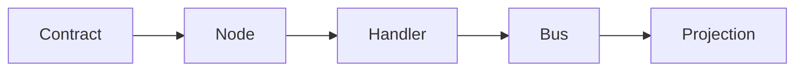

# What OmniNode is, and where it stands

*State as of 2026-10-17. This page is the canonical one-page overview of OmniNode. When it and
another page disagree about what ships, this page and the guide it links are the ones to trust,
and the disagreement is a bug in the other page.*

## In one paragraph

OmniNode lets you hand coding-agent work to a model you choose: a model you run on your own
machine or network, or a provider you pay for on your own API key. The model call goes from your
machine to that model directly and never passes through OmniNode. Every run leaves a receipt on
your machine that names the model that answered, and a meter that prices each run against a
baseline model, so you can see what the work cost and what it would have cost on the baseline.
OmniNode does not sell inference and does not mark it up; you pay your provider, or nobody if you
run the model yourself.

## Who it is for

- **Developers and teams who use coding agents** such as Claude Code and want to move part of
  that work onto cheaper or self-hosted models without losing track of which model did what, or
  what it cost.
- **Developers building on the ONEX runtime**, the open platform underneath delegation: typed
  contracts, four node kinds and an event bus. Delegation itself is built as ONEX nodes.

## How one delegation works

1. You run `onex delegate "<task>"` in a terminal, or `/onex:delegate <task>` inside Claude Code.
2. Routing picks a model from the ones you declared. Your own model server is tried first if you
   declared one; your provider key is used when there is no local model or the local answer does
   not clear the quality bar.
3. Your machine calls that model directly, on your endpoint or your key.
4. The answer prints, and the run folder `~/.onex_state/runs/<run id>/` keeps the answer, the
   request and `receipt.json`, which names the provider or server, the model and the status.
5. `onex metering` totals the runs: tokens, spend, the same calls priced on a baseline model, and
   the difference. `onex dashboard` shows each run and its receipt in a browser page served only on
   your own machine.

The [Delegation quickstart](delegation-quickstart.md) walks through all of it in about 15
minutes, with what you should see at each step.

## What ships today

Everything in this list installs from public packages (`omnibase-core`, `omnibase-infra` and
`omnimarket` on PyPI, all MIT-licensed) and runs on your own machine with no OmniNode account.

| Capability | How you reach it |
|---|---|
| Local install | One `uv tool install` line gives you the `onex` command. Apple Silicon Mac and Linux install from prebuilt wheels; Intel Mac builds from source. See [Supported platforms](supported-platforms.md). |
| Machine identity | `onex local init`, once per machine. |
| Delegation to your own model or your own key | `onex delegate`. A model server that speaks the OpenAI chat-completions API, or an OpenRouter or GLM key registered with `onex secret set`. |
| Receipts | `receipt.json` in every run folder, naming who answered. |
| Metering against a baseline | `onex metering`, for all time, today or one day, as text or JSON. |
| Local dashboard | `onex dashboard`, bound to a loopback address only. |
| Claude Code plugin | `onex@omninode-tools`, which adds the one skill `/onex:delegate`. |
| The ONEX runtime | The node and contract model, with an in-process event bus and local SQLite state by default, that delegation is built on. See [Building on the ONEX runtime](getting-started-local.md). |

## In beta

The beta for invited outside users exercises the delegation path above: the quickstart, the
plugin, receipts, metering and the dashboard. Beta users follow the same public quickstart as everyone
else.

## Not yet open

**The hosted service.** OmniNode runs a hosted delegation service, but it is not open to outside
users yet: accounts are granted from a waitlist rather than self-served. Nothing on the shipped path needs
it. When it opens, it hosts orchestration, routing, receipts and metering; the model call is still
made on your own provider credential or your own model endpoint. See
[Connecting to the cloud](connecting-to-the-cloud.md) for its current state.

## What OmniNode does not do

- It does not sell, resell or mark up model inference.
- It does not route your model call through an OmniNode service on the shipped path.
- It does not read a provider key from your environment. A key is registered once with
  `onex secret set` and kept in a file under `~/.omninode/` that only your user account can read.

## Where to read next

| If you want to | Read |
|---|---|
| Try delegation | [Delegation quickstart](delegation-quickstart.md) |
| See how a delegation is dispatched | [Delegation dispatch](../architecture/delegation-dispatch.md) |
| See how a model is chosen | [Delegation routing contract](../architecture/delegation-routing-contract.md) |
| Understand how the repositories fit together | [Repository map and runtime concepts](../architecture/repository-map-and-runtime-concepts.md) |
| Build your own nodes | [Building on the ONEX runtime](getting-started-local.md) |
| Run the full stack yourself | [Self-hosting the full stack](getting-started-self-hosted.md) |
| Know why the platform is shaped this way | [Doctrine](../doctrine/README.md) |
| Browse everything | [Guides](README.md), [indexes](../indexes/README.md) |

## Business model boundary

Customers bring their own model endpoints or provider keys. OmniNode does not sell or mark up inference. The platform is open source; only the hosted cloud deployment architecture is private. These are product boundaries, not a statement of pricing for a future hosted offering.

## Five concepts

A **contract** declares the interface; a **node** has one of four archetypes; its **handler** implements behavior; the **bus** carries typed work; a **projection** provides a read model. See [the glossary](../reference/glossary.md).

The design aims for deterministic state transitions ([replay](../doctrine/deterministic-under-replay.md)), inspectable receipts ([evidence](../doctrine/evidence-is-first-class-output.md)), and explicit interfaces ([contracts](../doctrine/contracts-define-reality.md)). Model-independent routing lets users choose their own backends. Those properties are design criteria; measured cost and quality require a published experiment.

Read [Beta status](../reference/beta-status.md) for availability and [the delegation architecture guide](../architecture/delegation.md) for the current design map.
